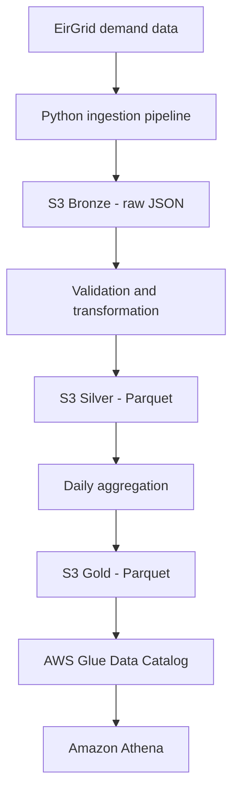

# Irish Energy Analytics Data Platform

An AWS data engineering portfolio project that ingests Irish electricity demand data, transforms it into analytics-ready Parquet datasets, and prepares it for querying with AWS Glue and Amazon Athena.

The project demonstrates data ingestion, data quality handling, columnar storage, daily aggregation, infrastructure as code, automated testing, and cloud cost controls.

## Project objectives

- Ingest electricity demand data from EirGrid.
- Preserve raw source data in an S3 Bronze layer.
- Transform and validate records into a Silver Parquet layer.
- Produce daily demand metrics in a Gold analytics layer.
- Define an AWS Glue Data Catalog database and external table.
- Configure Amazon Athena for analytical queries with a per-query scan limit.
- Test the transformation and orchestration logic automatically.

## Architecture



The pipeline separates raw, transformed, and aggregated data so that each stage has a clear purpose.

### Data lake layers

| Layer | Format | Purpose |
|---|---|---|
| Bronze | JSON | Retain ingested source data in S3 |
| Silver | Parquet | Store validated, transformed records |
| Gold | Parquet | Store daily demand metrics for analytics |

The Gold dataset includes the date, region, average demand, minimum demand, maximum demand, and number of observations.

Gold output uses a date-based partition layout:

```text
gold/eirgrid/daily_demand/
└── run_date=YYYY-MM-DD/
    └── daily_demand.parquet
```

## Technology stack

- **Language:** Python
- **Data processing:** Pandas and PyArrow
- **Storage:** Amazon S3
- **Data catalogue:** AWS Glue Data Catalog
- **Analytics:** Amazon Athena
- **Infrastructure as code:** AWS CDK
- **Testing:** pytest
- **Source control:** Git and GitHub

## Example analytics

Once the Gold data is registered and queryable in Athena, a daily demand trend can be explored with SQL:

```sql
SELECT
    date,
    region,
    average_demand_mw,
    minimum_demand_mw,
    maximum_demand_mw,
    observations
FROM irish_energy_analytics.daily_electricity_demand
WHERE run_date = 'YYYY-MM-DD'
ORDER BY date;
```

Replace `YYYY-MM-DD` with the partition date you want to query.

Possible analyses include:

- Comparing average electricity demand across days.
- Identifying daily demand peaks and minimums.
- Comparing demand patterns across available regions.
- Monitoring the number of observations contributing to each daily aggregate.

## Data quality

The transformation pipeline handles missing demand values and produces validated, analytics-ready output. The tested ingestion run processed 276 records, of which 13 were excluded because demand values were missing.

Automated tests cover the transformation, Gold aggregation, and pipeline orchestration logic.

## Cost controls

The CDK configuration defines an Athena workgroup with:

- A per-query data-scanned limit of 10 MiB.
- Enforced workgroup settings.
- CloudWatch metrics enabled.
- An S3 location for Athena query results.

The scan limit helps prevent unexpectedly large Athena queries. It does not eliminate all AWS costs; S3 storage, requests, and other resources may incur charges.

## Running the tests

Activate your project's Python virtual environment, then run:

```bash
python -m pytest -q
```

The latest recorded test run passed **58 tests**.

## Infrastructure synthesis

From the project root, synthesize the CDK template:

```bash
cd infrastructure
npx cdk synth
```

Synthesis generates the CloudFormation template. It does not deploy resources to AWS.

## Current implementation status

The following has been verified:

- The Python pipeline successfully ingested EirGrid demand data.
- Bronze JSON, Silver Parquet, and Gold Parquet objects were written to S3.
- The CDK stack synthesizes successfully.
- The automated test suite passed 58 tests.
- The code is version-controlled in GitHub.

**AWS permissions limitation:** Glue partition registration and Athena query execution were blocked by the restricted AWS developer identity. The relevant Glue and Athena operations have not been verified end-to-end. The CDK definitions exist, but successful synthesis alone does not establish that the Glue and Athena resources have been deployed.

The project intentionally retains the existing AWS permission restrictions.

## Repository structure

```text
.
├── infrastructure/       # AWS CDK infrastructure
├── src/                  # Ingestion, transformation and pipeline logic
├── tests/                # Automated tests
└── README.md             # Project documentation
```

## Future improvements

- Complete Glue partition registration and Athena query validation when the required permissions are available.
- Add scheduled ingestion and orchestration.
- Add data quality metrics and pipeline observability.
- Add CI to run tests and CDK synthesis on pull requests.
- Add sample query results and visualizations to demonstrate the analytics.

## Disclaimer

This is a portfolio and learning project. It is not an official EirGrid product or a production electricity-market reporting service.
