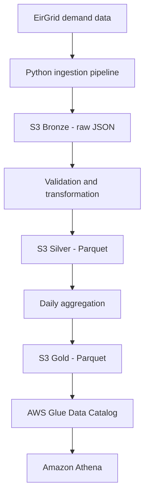

# Irish Energy Analytics Data Platform

An AWS data engineering portfolio project that ingests Irish electricity demand data, transforms it into analytics-ready Parquet datasets, and prepares it for querying with AWS Glue and Amazon Athena.

The project demonstrates data ingestion, data quality handling, columnar storage, daily aggregation, infrastructure as code, automated testing, and cloud cost controls.

## Project objectives

- Ingest electricity demand data from EirGrid.
- Preserve raw source data in an S3 Bronze layer.
- Transform and validate records into a Silver Parquet layer.
- Produce daily demand metrics in a Gold analytics layer.
- Define an AWS Glue Data Catalog database and external table.
- Configure Amazon Athena for analytical queries with a per-query scan limit.
- Test the transformation and orchestration logic automatically.

## Architecture



The pipeline separates raw, transformed, and aggregated data so that each stage has a clear purpose.

### Data lake layers

| Layer | Format | Purpose |
|---|---|---|
| Bronze | JSON | Retain ingested source data in S3 |
| Silver | Parquet | Store validated, transformed records |
| Gold | Parquet | Store daily demand metrics for analytics |

The Gold dataset includes the date, region, average demand, minimum demand, maximum demand, and number of observations.

Gold output uses a date-based partition layout:

```text
gold/eirgrid/daily_demand/
└── run_date=YYYY-MM-DD/
    └── daily_demand.parquet
```

## Technology stack

- **Language:** Python
- **Data processing:** Pandas and PyArrow
- **Storage:** Amazon S3
- **Data catalogue:** AWS Glue Data Catalog
- **Analytics:** Amazon Athena
- **Infrastructure as code:** AWS CDK
- **Testing:** pytest
- **Source control:** Git and GitHub

## Example analytics

Once the Gold data is registered and queryable in Athena, a daily demand trend can be explored with SQL:

```sql
SELECT
    date,
    region,
    average_demand_mw,
    minimum_demand_mw,
    maximum_demand_mw,
    observations
FROM irish_energy_analytics.daily_electricity_demand
WHERE run_date = 'YYYY-MM-DD'
ORDER BY date;
```

Replace `YYYY-MM-DD` with the partition date you want to query.

Possible analyses include:

- Comparing average electricity demand across days.
- Identifying daily demand peaks and minimums.
- Comparing demand patterns across available regions.
- Monitoring the number of observations contributing to each daily aggregate.

## Data quality

The transformation pipeline handles missing demand values and produces validated, analytics-ready output. The tested ingestion run processed 276 records, of which 13 were excluded because demand values were missing.

Automated tests cover the transformation, Gold aggregation, and pipeline orchestration logic.

## Cost controls

The CDK configuration defines an Athena workgroup with:

- A per-query data-scanned limit of 10 MiB.
- Enforced workgroup settings.
- CloudWatch metrics enabled.
- An S3 location for Athena query results.

The scan limit helps prevent unexpectedly large Athena queries. It does not eliminate all AWS costs; S3 storage, requests, and other resources may incur charges.

## Running the tests

Activate your project's Python virtual environment, then run:

```bash
python -m pytest -q
```

The latest recorded test run passed **58 tests**.

## Infrastructure synthesis

From the project root, synthesize the CDK template:

```bash
cd infrastructure
CDK_DEFAULT_ACCOUNT=851725545966 CDK_DEFAULT_REGION=eu-west-1 npx cdk synth
```

`CDK_DEFAULT_ACCOUNT` must be set to exactly `851725545966` (missing, blank or any other value stops synthesis), for offline
synthesis too. It is read from the environment only; no AWS call is made by the check.

Synthesis generates the CloudFormation template. It does not deploy resources to AWS.

## Current implementation status

The following has been verified:

- The Python pipeline successfully ingested EirGrid demand data.
- Bronze JSON, Silver Parquet, and Gold Parquet objects were written to S3.
- The CDK stack synthesizes successfully.
- The automated test suite passed 58 tests.
- The code is version-controlled in GitHub.

**AWS permissions limitation:** Glue partition registration and Athena query execution were blocked by the restricted AWS developer identity. The relevant Glue and Athena operations have not been verified end-to-end. The CDK definitions exist, but successful synthesis alone does not establish that the Glue and Athena resources have been deployed.

The project intentionally retains the existing AWS permission restrictions.

## Repository structure

```text
.
├── infrastructure/       # AWS CDK infrastructure
├── src/                  # Ingestion, transformation and pipeline logic
├── tests/                # Automated tests
└── README.md             # Project documentation
```

## Future improvements

- Complete Glue partition registration and Athena query validation when the required permissions are available.
- Add scheduled ingestion and orchestration.
- Add data quality metrics and pipeline observability.
- Add CI to run tests and CDK synthesis on pull requests.
- Add sample query results and visualizations to demonstrate the analytics.
- Production readiness findings and the administrator handover:
  [docs/production-readiness-review.md](docs/production-readiness-review.md) and
  [docs/administrator-handover.md](docs/administrator-handover.md).
- Hostnames, ACM certificates and Route 53 records for the energy edge stacks:
  [docs/deployment-dns-and-certificates.md](docs/deployment-dns-and-certificates.md).
- Secure and productionise the API: see
  [docs/security-and-production-architecture.md](docs/security-and-production-architecture.md)
  and the phased plan in
  [docs/api-security-implementation-plan.md](docs/api-security-implementation-plan.md).

## Disclaimer

This is a portfolio and learning project. It is not an official EirGrid product or a production electricity-market reporting service.

## Run history storage

The API stores pipeline run history in a local SQLite file
(`RUN_HISTORY_DB_PATH`, default `.local/run_history.sqlite3`, git-ignored) so
records survive restarts. On startup, runs left `queued` or `running` by a
previous process are marked `interrupted` because their outcome is unknown.

This is for local development with a single API process only. A SQLite file on
an ECS task's ephemeral filesystem is lost when the task is replaced and must
not be shared between tasks. A future deployment should use a shared store such
as DynamoDB, with explicitly scoped IAM permissions, behind `src/run_store.py`.

Inspect it read-only: `sqlite3 -readonly .local/run_history.sqlite3 "SELECT run_id, status, stage, created_at FROM runs ORDER BY created_at DESC LIMIT 10;"`

## Container image

The API image is built from the repository root (the build context is limited by
`.dockerignore` to `requirements-api.txt` and `src/`):

```bash
docker build --platform linux/amd64 -t irish-energy-api:local .

# Local mode with the Cognito settings (no AWS credentials are baked in; pass them only
# if you choose to read real S3 data, never in the image). API_ENV=production additionally
# requires RUN_HISTORY_BACKEND=dynamodb and RUN_HISTORY_TABLE and exits otherwise.
docker run --rm -p 8000:8000 --read-only --tmpfs /tmp --cap-drop ALL \
    -e API_ENV=local \
  -e COGNITO_REGION=eu-west-1 -e COGNITO_USER_POOL_ID=<pool id> -e COGNITO_APP_CLIENT_ID=<client id> \
  -e CORS_ALLOWED_ORIGINS=https://energy.ai-autofy-general-server.com \
  -e S3_BUCKET=<bucket> \
  irish-energy-api:local
curl -i http://127.0.0.1:8000/health      # 200, needs no token
curl -i http://127.0.0.1:8000/api/runs    # 401 without a Cognito access token
```

The image runs as a non-root user (10001), serves with Uvicorn on `0.0.0.0:${PORT}`
(default 8000), and has a built-in health check (`python -m src.healthcheck`). Without the `COGNITO_*` settings, or without `RUN_HISTORY_BACKEND=dynamodb` and `RUN_HISTORY_TABLE`, `API_ENV=production` refuses to start. Pipeline execution is
disabled and cannot be enabled by configuration. Locally, run history uses SQLite under `/tmp`; in production it is the shared DynamoDB table. An optional real build test is
`RUN_DOCKER_TESTS=1 pytest tests/test_container_image.py`.

## Running the API locally

```bash
API_ENV=local S3_BUCKET=<bucket> AWS_PROFILE=<profile> \
  .venv/bin/uvicorn src.api:app --host 127.0.0.1 --port 8001
```

`API_ENV` defaults to `production`, which allows no CORS origins and serves no
API docs; `local` allows the Vite dev origins. `POST /api/runs` returns 503
because pipeline execution is disabled and cannot be enabled by configuration
until authentication and managed execution exist. Install test dependencies
with `pip install -r requirements-dev.txt`.

Only `/health` is public. The other routes require a Cognito access token
(`Authorization: Bearer ...`) from a user in the `viewer` or `operator` group,
verified against the pool configured by `COGNITO_REGION`,
`COGNITO_USER_POOL_ID` and `COGNITO_APP_CLIENT_ID`. If these are unset the
protected routes return 503 rather than allowing access, so the dashboard shows
errors until frontend sign-in is added. There is no authentication bypass.

With `API_ENV=production` the app refuses to start unless all three `COGNITO_*`
variables are set and valid. Read endpoints are rate limited per user
(`RATE_LIMIT_READ_PER_MINUTE` 60, `RATE_LIMIT_ANALYTICS_PER_MINUTE` 30,
`RATE_LIMIT_WRITE_PER_HOUR` 5, `RATE_LIMIT_AUTH_FAILURES_PER_MINUTE` 20 per
client address) and return 429 with `Retry-After`. Limits are held in memory per
API process, so running several processes or tasks multiplies them; add a shared
limit (for example a WAF rate rule) before scaling out. Behind a proxy, start
uvicorn with `--proxy-headers --forwarded-allow-ips=<proxy address>` so client
addresses are real. Responses carry an `X-Request-ID`; the same ID appears in the
JSON server logs, which redact tokens and secrets. Client responses never include
bucket names, S3 keys, raw exception text or stack traces.

## Frontend sign-in

The dashboard signs in through the Amazon Cognito Hosted UI using the OAuth 2.0
authorization-code flow with PKCE (AWS Amplify Auth). It needs an existing
Cognito user pool and a public app client (no client secret) that you or an
administrator create; nothing in this repository creates or changes Cognito.
Copy `frontend/.env.example` to `frontend/.env.development.local` (git-ignored)
and set:

| Variable | Format |
|---|---|
| `VITE_COGNITO_USER_POOL_ID` | `eu-west-1_AbC123xyz` |
| `VITE_COGNITO_APP_CLIENT_ID` | alphanumeric app client ID |
| `VITE_COGNITO_DOMAIN` | hosted UI domain, host name only, no `https://` |
| `VITE_COGNITO_REDIRECT_SIGN_IN` / `_SIGN_OUT` | exact callback and sign-out URLs registered on the app client (`https://`, or `http://localhost`/`127.0.0.1` for development) |
| `VITE_COGNITO_SCOPES` | optional, default `openid` |

The same pool and client IDs must be passed to the API as `COGNITO_REGION`,
`COGNITO_USER_POOL_ID` and `COGNITO_APP_CLIENT_ID`, and users need to be in the
`viewer` or `operator` Cognito group. If the frontend variables are missing or
invalid the app shows which ones and does not run; there is no sign-in bypass.

Tokens are kept in memory only, so reloading the page asks you to sign in again
(usually instant while the Cognito session is active). The API receives the
access token as `Authorization: Bearer ...`; the ID token is never sent. Group
names shown in the UI come from that session and only affect what is displayed.
The API enforces access, and pipeline execution stays disabled for everyone.
Run the frontend tests with `npm test` in `frontend/`.

## Shared run history (design)

Run history can be kept in a shared DynamoDB table instead of local SQLite
(`RUN_HISTORY_BACKEND=dynamodb`, `RUN_HISTORY_TABLE`, optional
`RUN_HISTORY_REGION`). The table, Step Functions workflow and least-privilege IAM
policies are specified as data in `infrastructure/run_control/spec.py` and
explained in `docs/adr/0001-shared-run-history-and-step-functions.md`, including
migration and rollback. A DynamoDB gateway VPC endpoint with a table-and-index-only policy keeps the API's run-history traffic on the AWS network (no hourly endpoint charge; defined and tested by offline synthesis, not deployed or verified against AWS). Nothing is deployed, the Step Functions executor is not wired into the API, and pipeline execution stays disabled.

## Pipeline stage Lambda functions (Phase 9.4)

Four Lambda container functions (Bronze, Silver, Gold, Glue registration) wrap the existing stage
code (`src/pipeline_stages.py`). They share one image (`Dockerfile.lambda`) and are defined in
`infrastructure/stacks/energy_pipeline_stack.py` with separate least-privilege roles. Build locally with
`docker build --platform linux/amd64 -f Dockerfile.lambda -t irish-energy-pipeline:local --load .`.
Not deployed, not published and never invoked; the Step Functions state machine is the next phase
and pipeline execution remains disabled. See `docs/administrator-handover.md`.

## Step Functions workflow (Phase 9.5)

A Standard state machine (`infrastructure/stacks/energy_workflow_stack.py`, built from
`infrastructure/run_control/spec.py`) chains the four Lambda stages and records progress in the
DynamoDB run history with native integrations. Input is `{"run_id", "days_back"}`; retries cover
Lambda service errors only and every failure ends the execution as `FAILED`. The API task role gained
dormant `states:StartExecution` and `states:DescribeExecution` permissions on this one state machine,
and the container gets `PIPELINE_STATE_MACHINE_ARN`. Synthesised and tested locally only: not
deployed and never executed. Pipeline execution remains disabled and `POST /api/runs` still returns
503. See `docs/administrator-handover.md`.

## Pipeline integration and reliability tests (Phase 9.6)

`tests/pipeline_harness.py` runs the real stage handlers, the synthesised state machine (via a small local interpreter),
the DynamoDB run store and the Step Functions executor against local doubles, with no AWS access. Bronze and Silver
objects now carry the run ID in their names, transient EirGrid errors are retried with bounded backoff, and
the failure, retry, lock, reconciliation and security scenarios are covered by tests. This is local simulation only:
nothing has been deployed or run against AWS and pipeline execution remains disabled. See
`docs/administrator-handover.md` for contracts, findings and known limitations.

## Reconciliation and lock recovery (Phase 9.6.1)

`src/reconciliation.py` settles run history from the real Step Functions status (never interrupting a running execution),
releases stale locks only for the run that owns them, and the executor refuses to start a run behind an expired lease with a
live execution. An optional scheduled function (`src/reconcile_runs.py`, `-c reconcilerEnabled=true`, schedule disabled by
default) can run it independently of the API with minimal permissions. Local tests only: nothing is deployed, the scheduler
is not created, pipeline execution remains disabled and real AWS behaviour (including Lambda error names) is unverified.
See `docs/administrator-handover.md`.

## Production readiness assessment (Phase 9.7)

`docs/phase-9.7-production-readiness.md` assesses the platform before any AWS deployment: resource inventory, IAM matrix,
security, network and HTTPS findings, Cognito and certificate prerequisites, cost estimate, deployment and rollback plan.
Verdict: ready after specified blockers are resolved (unverified deployment identity and bootstrap state, certificates, Cognito,
and several runtime behaviours that only a real account can confirm). Nothing was deployed; pipeline execution and the
reconciler schedule remain disabled.

## AWS administrator preparation (Phase 9.7.2)

`docs/phase-9.7.2-administrator-preparation.md` and `docs/iam/` prepare a least-privilege deployment package for an AWS
administrator: separate deployer, CloudFormation execution and read-only identities, nine reviewable policy documents, the
CDK bootstrap strategy (dedicated qualifier and toolkit stack recommended), PassRole and ECR publication analysis, rollback
and a read-only verification checklist. Proposals only: nothing was applied, no AWS call was made, the developer identity
is unchanged, and pipeline execution and the reconciler schedule stay disabled.

Phase 9.7.2.1 (`docs/phase-9.7.2.1-boundary-hardening.md`) adds a proposed runtime permissions boundary, a role-creation policy
that allows only nine named roles and only with that boundary, an optional frontend publishing policy, and a decision to
neutralise the API's `states:StartExecution` through the boundary until execution is separately approved. Policies only; the
CDK application is unchanged.

Phase 9.7.2.2 (`docs/phase-9.7.2-administrator-preparation.md`, section 14) removes CloudFront and site-bucket permissions from
the general execution policy (the frontend stack becomes a supervised deployment), scopes listener and rule permissions to a fixed
load balancer name (`irish-energy-api`, a one-line change in the edge stack), and moves trust-policy updates to a temporary policy.

Limits of the administrator package (details in `docs/iam/README.md` and the phase documents):

- Offline tests (five files: `tests/test_iam_policy_package.py`, `test_iam_boundary.py`, `test_iam_isolation.py`, `test_iam_readonly_secrets.py`, `test_iam_inspection_policies.py`)
  use local models and invented game ARNs; the game's real resources have not been inspected. Pattern-level tests do not establish
  effective AWS authorization, which is confirmed only during supervised deployment.
- Outstanding AWS-dependent assumptions (each fails closed): fixed-name load-balancer scoping, ECS task-definition deregistration
  resource-level support, the exact SSM bootstrap-version parameter ARN, the IAM permissions-boundary and `aws:PrincipalArn` behaviour, the EC2 and target-group tag
  conditions, `states:CreateStateMachine` scoping, and the `logs:DescribeLogGroups` wildcard (`Resource: "*"`, not an account-wide ARN).
- The policy documents do not grant deletion of the protected stateful stacks (data lake, registry, run history); `rollback-policy.json`
  explicitly denies it, and also denies deleting `CDKToolkit*` stacks. This is a policy choice, not a technical impossibility in AWS.
- Read-only inspection includes CDK bootstrap metadata and the bootstrap role policies that match the configured qualifier. If the qualifier is
  shared with the game, that can include the game's bootstrap metadata; it is inspection only.
- The general read-only policy grants neither `lambda:GetFunction`, `lambda:GetFunctionConfiguration` (environment values, package URL) nor `ssm:GetParametersByPath`; Lambda
  resource policies are read with `lambda:GetPolicy` on the five project functions, and configuration is verified from reviewed templates or by a separately authorised identity without recording the output.
- `route53:ListResourceRecordSets`, `cloudformation:DescribeStackEvents` and `cognito-idp:DescribeUserPool` are not in the general read-only policy: each is a separate
  inspection policy (`dns-inspection-policy.json`, `cloudformation-diagnostic-policy.json`, `cognito-inspection-policy.json`) that needs explicit administrator approval and exposes
  information (the whole shared zone, stack resource properties, SMS and Lambda trigger settings). Read-only is not the same as safe; behavior is unverified until separately authorised testing.
- Frontend creation is a supervised administrator operation; which identity carries its temporary permissions is an open administrator decision.

## Local production-readiness corrections (Phase 9.7.1)

`docs/phase-9.7.1-local-corrections.md`: all stacks are pinned to account `851725545966`/`eu-west-1` and a different
active account stops synthesis; a production frontend build (`npm run build`) refuses to run without the production
API and Cognito settings (`npm run build:local` is for local use only); documentation corrections and the Lambda
trust-condition review. Nothing was deployed.

## Deployment readiness audit (Phase 9.7.3)

`docs/iam/phase-9.7.3-deployment-readiness.md` audits the repository for a first AWS deployment and gives the stack dependency diagram, deployment order, runbook with approval-gated commands, and findings classified BLOCKER, HIGH, MEDIUM and LOW. Status: **READY FOR ADMINISTRATOR PREPARATION**; not ready for a controlled first deployment. Offline checks do not establish effective AWS permissions.

`docs/iam/phase-9.7.4-bootstrap-and-deployment-identity.md` resolves the offline part of the bootstrap findings: it recommends a dedicated CDK qualifier and toolkit stack with scoped deployment and execution roles (`docs/iam/bootstrap/`, not applied) and the availability-zone lookup no longer needs the lookup role (`infrastructure/app.py`).
