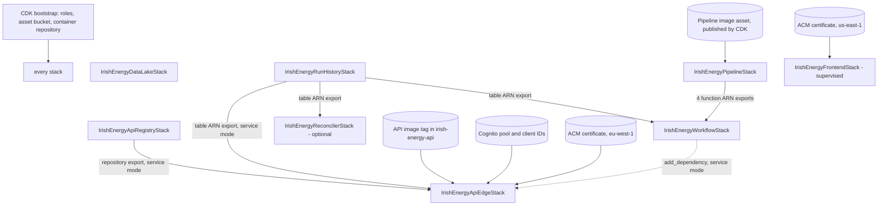

# Phase 9.7.3: final AWS deployment readiness audit and runbook
## Current status update — 30 October 2026

**This update supersedes the historical AWS preparation status recorded below.**
The original Phase 9.7.3 audit is preserved as a record of the position at the
time it was written. Statements in that audit that IAM objects had not been
created refer to that earlier baseline, not the current position.

### IAM preparation completed

The following AWS IAM resources have subsequently been created:

- Runtime permissions boundary:
  `irish-energy-runtime-boundary`.
- Deployment permissions boundary:
  `irish-energy-deployment-boundary`.
- Seven managed deployment policies for CloudFormation execution and
  deployment operations.
- IAM operator user:
  `irish-energy-deployer-operator`.
- Dedicated deployment role:
  `irish-energy-cdk-deployer`.
- The operator's restricted AssumeRole permission and the deployer's
  deployment permissions.

The runtime and deployment permissions boundaries have been created but
**have not been attached** to their intended roles. The seven managed
deployment policies have been created but **have not been attached** to the
CloudFormation execution role.

The deployment boundary was validated using IAM Access Analyzer with no
findings. Its attachment count remains zero. This validation does not prove
that every future CloudFormation operation will succeed or that the complete
deployment configuration is secure.

### Bootstrap and deployment status

The dedicated CDK bootstrap template has been prepared locally:

- Qualifier: `energydev01`.
- Intended bootstrap stack: `CDKToolkit-energydev01`.
- Intended deployment permissions boundary:
  `irish-energy-deployment-boundary`.
- The existing default `CDKToolkit` stack is to remain untouched.

**The dedicated bootstrap stack has not been created.**
Neither `cdk bootstrap` nor `cdk deploy` has been run for this project.
The bootstrap template and associated IAM documentation are local
preparation artifacts, not evidence of a completed bootstrap.

The API and frontend ACM certificates have been issued and their DNS
validation records have been confirmed. Cognito preparation and the
remaining deployment prerequisites must still be checked separately.

### Runtime safeguards and scope

- Pipeline execution remains disabled by default.
- The reconciler schedule remains disabled by default.
- The initial runtime permissions boundary explicitly denies
  `states:StartExecution`.
- The separate execution-activation boundary has not been created or applied.
- The existing game infrastructure and its hostnames remain outside this
  project's scope and must not be modified.

### Outstanding work

Before any deployment:

1. Review and commit the IAM policy package and bootstrap template.
2. Complete a final review of the seven deployment policies and their
   resource and condition restrictions.
3. Confirm the deployment identity, trust relationships and permissions
   boundary configuration.
4. Resolve the remaining Cognito and infrastructure prerequisites.
5. Establish an AWS budget and cost alerts.
6. Obtain explicit administrator approval before creating the dedicated
   bootstrap stack or deploying any application stack.

**Current overall status: IAM preparation partially completed;
dedicated bootstrap and application deployment not yet performed.**

---

> **Historical snapshot:** The following audit sections record the position
> at the time of the original Phase 9.7.3 review. Their AWS resource and IAM
> status statements have not been rewritten to reflect subsequent work.
> For the current position, use the status update above.

Status: **audit and documentation only.** Nothing was deployed or bootstrapped, no AWS API was called, no AWS CLI command was run, no AWS identity,
policy or resource was created or changed, no image was built or pushed, no credential or private-key file was read, and nothing is staged or committed.
Pipeline execution is disabled and the reconciler schedule is disabled by default. The game (hostnames `api.` and `play.`, its ALB, distribution, certificate
and bootstrap, if any) is out of scope and was not inspected. Baseline: commit `4fdd2fe` plus the uncommitted Phase 9.7.2.x work.

Method: the repository was read directly (CDK app and nine stacks, shared configuration, the 18 IAM policy documents, Dockerfiles, API settings and routes,
state machine specification, frontend configuration, documents) and the synthesized templates and manifest of every configuration were inspected offline.
Where an item depends on the real account it is labelled **unverified** or **administrator prerequisite**. Offline tests use local models; they do not prove
effective AWS permissions or behavior. Every command below that would change AWS is marked **REQUIRES EXPLICIT ADMINISTRATOR APPROVAL** and was not run.

## 1. Executive summary

The repository side is in good shape: 1,270 backend and infrastructure tests, 90 frontend tests, a production frontend build that refuses local defaults,
five synthesis configurations that produce 5, 7, 7, 8 and 8 stacks with no dependency cycle, and 18 valid, size-compliant IAM policy documents. What stands
between this repository and a first controlled deployment is almost entirely on the AWS side and is currently unknown or not yet created: the bootstrap
environment, the IAM identities and policies, certificates, Cognito, the state of the Glue and Athena objects, and several decisions. The audit also found
four design issues that the earlier phase reports did not state (section 16: B-4, B-5, H-1 and H-10).

**Overall status: READY FOR ADMINISTRATOR PREPARATION.** It is **not** ready for a controlled first deployment, because critical prerequisites are unknown
(section 16).

## 2. Current readiness status

| Area | Status | Basis |
|---|---|---|
| Application and tests | ready | offline test, lint and build results (section 15) |
| CDK synthesis, dependencies | ready | five configurations, manifest dependencies, no cycle |
| Pipeline and API guards | ready | execution refuses to start; `POST /api/runs` returns 503; boundary denies `states:StartExecution`; schedule `DISABLED` |
| IAM policy package | proposals ready for review, nothing created | 18 documents, 9 unresolved placeholders |
| Bootstrap | **unknown** | not determinable from the repository |
| Certificates, DNS, Cognito | **not prepared / unverified** | no certificate, hosted-zone or user-pool identifier exists in the repository |
| Data lake and Glue/Athena state | **unknown** | the handover says both "deployed" and "unestablished" |
| Cost and monitoring | **not prepared** | no budget, alarms or alerts |

## 3. Stack dependency diagram

Taken from the synthesized manifest (`dependencies`) and the CloudFormation imports. "service mode" means `-c apiImageTag`, `-c cognitoUserPoolId` and `-c cognitoAppClientId`.

No circular dependency exists. DataLake, Registry, RunHistory, Pipeline and Frontend have no stack dependency. The reconciler's reference to the state machine is a
derived ARN string, not an import, so it does not depend on the workflow stack.

## 4. Stack deployment order and per-stack facts

The proposed order is **correct against the implementation**, with these refinements: Registry, RunHistory and Pipeline are mutually independent (any order);
Workflow must follow Pipeline and RunHistory; the optional Reconciler must follow RunHistory; the edge stack in service mode must follow Registry, RunHistory and Workflow and
needs the API image already published; Frontend is independent but supervised.

Recommended order: 1 DataLake (only after the state check, B-6), 2 ApiRegistry, 3 RunHistory, 4 Pipeline, 5 Workflow, 6 Reconciler (optional, schedule `DISABLED`), 7 ApiEdge,
8 Frontend (supervised). **Deploy each stack by name with `--exclusively`**: because stacks depend on each other, `cdk deploy IrishEnergyApiEdgeStack` without it also deploys
Workflow, Pipeline, RunHistory and Registry (finding H-10).

| Stack | Main resources | Context and parameters | Depends on | Independent | Replacement or deletion of existing resources | Shared AWS resources |
|---|---|---|---|---|---|---|
| `IrishEnergyDataLakeStack` | Glue database `irish_energy_analytics`, Glue table `daily_electricity_demand`, Athena workgroup `irish-energy-analytics` (10 MB per-query cap) | none | the existing bucket `irish-energy-data-platform-851725545966` (imported by name, not created) | yes | fixed names: creation fails with already-exists if the objects exist; a rename would need replacement, which CloudFormation refuses for custom names | the bucket (pre-existing; its policy and other users unknown); Glue catalog of the account |
| `IrishEnergyApiRegistryStack` | ECR repository `irish-energy-api` (immutable tags, scan on push, lifecycle: untagged 14 days, keep 30 images), retained | none | none | yes | fixed name; retained, so a failed first creation leaves it and blocks a redeploy | none beyond the ECR registry |
| `IrishEnergyRunHistoryStack` | DynamoDB table `irish-energy-run-history` (on demand, GSI `gsi1`, TTL, point-in-time recovery, SSE, deletion protection), retained | none | none | yes | fixed name; retained and protected | none |
| `IrishEnergyPipelineStack` | four Lambda functions `irish-energy-pipeline-*` (container image, x86_64), four roles, four log groups (30 days, destroy on delete), four function ARN exports | none | CDK image asset (Docker at deploy time, bootstrap image repository) | yes | fixed function and log-group names; the image tag is the asset hash, so a code change updates the function in place | bootstrap repository and asset bucket |
| `IrishEnergyWorkflowStack` | Standard state machine `irish-energy-pipeline`, its role | none | Pipeline (4 imports), RunHistory (table ARN) | no | fixed name | none |
| `IrishEnergyReconcilerStack` (optional) | Lambda `irish-energy-run-reconciler` (zip asset), two roles, log group, EventBridge Scheduler schedule `irish-energy-run-reconciler` (rate 5 minutes, `DISABLED` unless `-c reconcilerScheduleState=ENABLED`) | `-c reconcilerEnabled=true` | RunHistory | no | fixed names | bootstrap asset bucket; the Scheduler default group |
| `IrishEnergyApiEdgeStack` | own VPC (2 public subnets, no NAT), internet gateway, two security groups, ALB `irish-energy-api` (deletion protection, TLS 1.3/1.2 policy), listeners 80 and 443, ECS cluster, Fargate service (1 task, 256 CPU, 1024 MiB), task definition, two roles, log group (retained), S3 and DynamoDB gateway endpoints (service mode) | `-c apiCertificateArn`, `-c frontendCertificateArn` (both required even though only the first is used here); service mode adds `-c apiImageTag`, `-c cognitoUserPoolId`, `-c cognitoAppClientId`; needs the `availability-zones` context lookup (B-5) | Registry, RunHistory, Workflow (service mode); the API image must already exist | yes without service mode (503 placeholder) | fixed ALB name (section 11); the 503-placeholder to service transition may collide (H-1) | its own VPC; certificate by ARN; **no game resource is referenced** |
| `IrishEnergyFrontendStack` | private S3 site bucket (generated name, retained), bucket policy, CloudFront distribution (alias `energy.`, TLS 1.2 minimum), origin access control, response-headers policy | both certificate ARNs | none | yes | generated names; retained bucket | CloudFront and the us-east-1 certificate are account-level; the shared zone for DNS |

Required IAM per stack is in `docs/phase-9.7.2-administrator-preparation.md`, section 2 (matrix), and `docs/iam/README.md`. The Frontend stack's permissions are deliberately **not** in the
general execution policy (section 11 of this document and finding B-9).

## 5. IAM identity preparation

All 18 documents were reviewed. Results (offline, from the documents themselves):

| Check | Result |
|---|---|
| Valid JSON and size | all 18 valid; largest 5,935 of 6,144 characters |
| Placeholders documented | 8: `REPLACE_SITE_BUCKET`, `REPLACE_DISTRIBUTION_ID`, `REPLACE_OAC_ID`, `REPLACE_RESPONSE_HEADERS_POLICY_ID`, `REPLACE_USER_POOL_ID`, `REPLACE_HOSTED_ZONE_ID`, `REPLACE_API_CERT_ID`, `REPLACE_FRONTEND_CERT_ID`; none was invented |
| Wildcard resources | 16 statements with `Resource: *`: caller identity, ECR login token, ECS task-definition register and describe, `logs:DescribeLogGroups`, EC2 and ELB describe, six general-verification list or describe calls, four boundary statements (the registry token and an explicit `states:StartExecution` Deny in each of the two variants). No wildcard actions |
| Game access | no statement names a game resource (tests use invented game ARNs; the real game resources were not inspected). EC2 and target-group scoping rely on the `Project` tag; unverified |
| Secrets and data | the general verification policy cannot read objects, image layers, function packages or configuration, items, secrets or keys; the three sensitive inspection reads are separate and approval-gated |
| Boundary | allow-list for nine roles; initial boundary has no Allow and an unconditional Deny for `states:StartExecution`; the activation variant allows it only for the API task role and Denies everyone else; neither grants any IAM, STS or CloudFormation action, so no runtime role can modify policies or boundaries |
| PassRole | only nine role patterns, each with an `iam:PassedToService`; the deployer may pass only the execution role |
| Execution role vs bootstrap | no SSM, S3 write or bootstrap-role permission; read-only `ecr:` pull on the bootstrap repository only. See B-4 for the deploy role |
| Inspection policies | `dns-inspection-policy.json`, `cloudformation-diagnostic-policy.json`, `cognito-inspection-policy.json` are single read actions, exact scopes, approval-gated; not attached to the verifier |

**Permissions that could replace, delete or modify an existing resource** (all fail closed if their scoping is unsupported): the execution role may update and delete only the
five Lambda functions and their log groups, the project state machine and schedule, ECS resources named `IrishEnergyApiEdgeStack-*`, tagged EC2 resources, the `irish-energy-api` load
balancer (and tagged target groups), nine named roles; it may update the Glue table and database, the Athena workgroup, the ECR repository settings (including lifecycle and tag mutability),
and the DynamoDB table settings; it cannot delete the table, repository, Glue or Athena objects, or any bucket. The deployer may push immutable tags to `irish-energy-api` and, optionally,
cancel, roll back or delete four stateless stacks. **Not covered by these documents: the bootstrap deploy role (B-4).**

Identity preparation (all by the IAM administrator, none done): create the permissions boundary `irish-energy-runtime-boundary` from `runtime-permissions-boundary.json`; create the six execution policies as
customer managed policies; create the deployer role (`deployment-identity-policy.json`, `ecr-publishing-policy.json`, optionally `rollback-policy.json`); create the read-only verifier role; keep the three inspection
policies and the temporary policies (`iam-trust-update-policy.json`, `frontend-stack-update-policy.json`, `frontend-publishing-policy.json`) detached until approved.

## 6. CDK bootstrap preparation

- **Expected today:** the synthesized manifest uses the default synthesizer, qualifier `energydev01` (Phase 9.7.4 sets it in `cdk.json` and `app.py`), bootstrap version 6 or later, roles `cdk-energydev01-{deploy,file-publishing,image-publishing,cfn-exec}-role-851725545966-eu-west-1`, asset bucket `cdk-energydev01-assets-851725545966-eu-west-1`, image repository `cdk-energydev01-container-assets-851725545966-eu-west-1`, and version parameter `/cdk-bootstrap/energydev01/version`. The default bootstrap (`hnb659fds`) is not referenced.
- **Discovery (read-only, administrator):** the qualifier of an existing bootstrap is the `Qualifier` parameter of the `CDKToolkit*` stack:
  `aws cloudformation describe-stacks --query "Stacks[?starts_with(StackName,'CDKToolkit')].{N:StackName,S:StackStatus,Q:Parameters[?ParameterKey=='Qualifier'].ParameterValue}"`; then read `/cdk-bootstrap/<qualifier>/version` (`ssm:GetParameter`). The general policy cannot list SSM parameters.
- **Roles and trust:** deploy, file-publishing and image-publishing roles must be assumable by the deployer (`deployment-identity-policy.json`); the execution role is `cdk-<qualifier>-cfn-exec-role-…` with the six project policies. By default all bootstrap roles trust the account root.
- **ECR publishing:** the pipeline image goes to the bootstrap repository through the image-publishing role; the API image goes to `irish-energy-api` through the deployer (`ecr-publishing-policy.json`). Whether the bootstrap repository policy lets Lambda pull is **unknown** (version 11 or later documents it).
- **Dedicated qualifier and toolkit stack:** recommended, because sharing with the game cannot be shown safe from the repository. Qualifier `energydev01` is set through the `cdk.json` context `@aws-cdk/core:bootstrapQualifier` (and `app.py`); the toolkit stack name is `CDKToolkit-energydev01`. The existing environment **cannot be determined from the repository: administrator prerequisite.**
- **Do not** run `cdk bootstrap` without `--qualifier` and `--toolkit-stack-name`.

## 7. Certificates, DNS and Cognito preparation

All of this is **administrator-supplied**; no identifier exists in the repository.

**API (eu-west-1):** an ACM certificate covering only `energy-api.ai-autofy-general-server.com`, status Issued, DNS-validated (a validation record in the shared zone, new record only). The ALB listener 443 uses it (`ELBSecurityPolicy-TLS13-1-2-2021-06`); port 80 redirects. After the edge stack: Route 53 A (and AAAA only if the ALB is dual-stack, which it is not configured to be) alias from `energy-api.` to the ALB (`AlbDnsName`, `AlbCanonicalHostedZoneId`). Health: ALB target group HTTP `/health` expects 200; the container health check runs `python -m src.healthcheck`.

**Frontend (us-east-1):** an ACM certificate for `energy.ai-autofy-general-server.com` only. The distribution uses origin access control to the private bucket, redirects HTTP to HTTPS, TLS 1.2 minimum, and serves `index.html` for 403 and 404. After the supervised creation: Route 53 A and AAAA alias to `DistributionDomainName` (hosted zone ID `Z2FDTNDATAQYW2` for CloudFront aliases, from the existing guide).

**Cognito (eu-west-1):** a user pool; a **public** app client with no secret using the authorization code flow with PKCE; callback and sign-out URL exactly `https://energy.ai-autofy-general-server.com/`; a hosted UI domain; scopes (frontend default `openid`; optional `VITE_COGNITO_SCOPES`); identity providers chosen by the administrator (the repository only assumes the user pool itself); groups `viewer` and `operator` with users assigned. The API validates access tokens: issuer from the region and pool, `token_use=access`, `client_id` equal to the configured client, signature from the pool's JWKS, and the `cognito:groups` claim for the role. Frontend build variables: `VITE_API_BASE_URL`, `VITE_COGNITO_USER_POOL_ID`, `VITE_COGNITO_APP_CLIENT_ID`, `VITE_COGNITO_DOMAIN`, `VITE_COGNITO_REDIRECT_SIGN_IN`, `VITE_COGNITO_REDIRECT_SIGN_OUT`. API variables are set by the stack: `COGNITO_REGION`, `COGNITO_USER_POOL_ID`, `COGNITO_APP_CLIENT_ID`, `CORS_ALLOWED_ORIGINS` (exactly the frontend origin). The client secret is never needed; a secret on the client is a finding.

## 8. Networking and connectivity matrix

Design: the edge stack owns a VPC with two public subnets, an internet gateway and route tables, no private subnets and **no NAT gateway**. Fargate tasks run in the public subnets with public IPs; the task security group allows ingress only from the ALB on 8000 and egress only TCP 443 to anywhere. Lambda functions are not attached to a VPC.

| Source | Destination | Protocol and port | Route | Guaranteed by configuration? | Test after deployment |
|---|---|---|---|---|---|
| Internet | ALB | TCP 443 and 80 | internet gateway, public subnets | configured (ALB security group allows 0.0.0.0/0 on both) | `curl` HTTPS and HTTP (expect 301) |
| ALB | ECS task | TCP 8000 | within the VPC | configured (egress and ingress rules created by CDK) | target group shows healthy |
| ECS task | ECR API and registry | TCP 443 | public IP via internet gateway | **not guaranteed** (no NAT, no interface endpoints; relies on the public IP and the 443 egress rule) | service reaches a steady state; image pulled |
| ECS task | S3 (image layers, Gold reads) | TCP 443 | S3 gateway endpoint (service mode) | configured | Gold read through the API |
| ECS task | DynamoDB | TCP 443 | DynamoDB gateway endpoint with a restrictive policy (table and `gsi1` only) | configured | `GET /api/runs` returns 200 |
| ECS task | CloudWatch Logs | TCP 443 | public IP via internet gateway | **not guaranteed** | log streams appear in the retained log group |
| ECS task | Cognito JWKS | TCP 443 | public IP via internet gateway | **not guaranteed; fetched lazily on the first authenticated request, so health checks cannot detect a failure** | an authenticated request with a real token |
| ECS task | Step Functions | TCP 443 | public IP | unused while execution is disabled | not tested in the first deployment |
| ECS task | task credentials | HTTP to the link-local endpoint | local | provided by ECS | task role works (S3 and DynamoDB reads) |
| Lambda stages | S3, Glue, Step Functions service, CloudWatch Logs | HTTPS | AWS-managed, no VPC | provided by Lambda | not exercised until the pipeline test |
| Lambda bronze | EirGrid (`www.smartgriddashboard.com`) | HTTPS | Lambda public egress | external; **not guaranteed** (third-party availability, rate limits) | first pipeline test |
| Scheduler, Step Functions | Lambda and DynamoDB | AWS-managed | service integration | provided; Lambda trust condition **unverified** (H-3) | not exercised while disabled |
| Browser | CloudFront, API, Cognito hosted UI | HTTPS | public | configured | sign-in test |
| Administrator workstation | ECR, CloudFormation | HTTPS | public | outside the repository | during deployment |

## 9. Container and application readiness

- **API image** (`Dockerfile`): `python:3.13-slim-bookworm` two-stage build, non-root user 10001, read-only root filesystem in the task definition, uvicorn with proxy headers, `HEALTHCHECK` via the standard library, port 8000, configuration only from the environment (no credentials). Build with `--platform linux/amd64`. Dependencies are pinned in `requirements-api.txt`.
- **Pipeline image** (`Dockerfile.lambda`): `public.ecr.aws/lambda/python:3.13`, one image for four functions; each function overrides the command (`src.pipeline_stages.ingest_handler`, `silver_handler`, `gold_handler`, `glue_handler`); x86_64; built as a CDK image asset with `--platform linux/amd64`, so Docker and public ECR access are needed on the deployment machine.
- **Runtime versions:** images use Python 3.13; local tests ran on Python 3.14 (M-4). Base image tags are not pinned by digest.
- **Task roles and environment:** execution role pulls the image and writes logs; the task role reads the Gold prefix and the run-history table; it also carries a dormant `states:StartExecution` that the initial boundary neutralises. Production settings are validated at startup (HTTPS CORS origin, Cognito settings, DynamoDB backend); no secrets are injected (`secret_arns` is empty).
- **Logging:** the API log group is retained (30 days); Lambda log groups are destroyed with their stacks (30 days); no alarms.

Order (and whether any stack needs an image first):
1. Registry stack creates `irish-energy-api`.
2. Build the API image; scan; publish with an explicit, never `latest`, tag (immutable). **The edge stack in service mode needs this image to exist** (otherwise the service fails to start and the circuit breaker rolls back).
3. The pipeline image is built and published **by `cdk deploy IrishEnergyPipelineStack`** itself through the image-publishing role; no image must pre-exist, but Docker must run and the bootstrap repository must exist.
4. Deploy the edge stack in service mode.
5. Build the frontend with the production variables and publish it (supervised).

## 10. Data and pipeline readiness

Source: EirGrid dashboard service (`DashboardService.svc/data`). Layout: Bronze `bronze/eirgrid/demand_actual/ingestion_date=YYYY-MM-DD/*.json`; Silver `silver/eirgrid/demand_actual/ingestion_date=YYYY-MM-DD/*.parquet`; Gold `gold/eirgrid/daily_demand/run_date=YYYY-MM-DD/daily_demand.parquet` (one canonical object per run date, replaced by the latest successful run). Glue external table `daily_electricity_demand` partitioned by `run_date`; Athena workgroup with a 10 MB per-query scan cap and results under `athena-results/`. DynamoDB holds run records and one lock item (`LOCK#pipeline`, lease 45 minutes, idempotency 24 hours). The Standard state machine chains four stages; the ingestion task retries `TransientEirGridError` three times (10, 20, 40 seconds), Lambda service errors twice, with a per-stage timeout and a catch that records failure. The reconciler (optional) settles interrupted runs from Step Functions outcomes and calls only `DescribeExecution`.

Confirmed in the repository: `PIPELINE_EXECUTION_ENABLED=true` stops start-up; `POST /api/runs` returns 503 (`Pipeline execution is disabled.`) for an authorised operator; `start_execution` appears only in `src/executor_stepfunctions.py`; the reconciler role and code have no `StartExecution`; the schedule is `DISABLED` unless a second context value is given; the initial boundary denies `states:StartExecution` for every runtime role.

**Proposed first pipeline test (not executed, separate explicit authorisation required):** it needs three things that do not exist yet: (a) a reviewed code change that lifts the settings guard, (b) the activation boundary variant applied by the IAM administrator, and (c) a run record, because the state machine's progress updates require an existing item (`attribute_exists(pk)`), so a bare manual start would fail its progress update. Then: one operator, one run, input `{"run_id": "<new lowercase UUID>", "days_back": 1}` created through `POST /api/runs`; watch the execution and the four stage logs; confirm one Bronze object, one Silver object, one Gold object for the date and the partition registration; confirm the run record settles and the lock is released; check Athena with the capped workgroup; revert the activation immediately afterwards. This procedure is not part of this deployment.

## 11. Shared-resource and rollback protection

| Resource | Kind | Replacement or deletion risk | Handling |
|---|---|---|---|
| Data lake bucket `irish-energy-data-platform-851725545966` | pre-existing, imported by name, **shared state unknown** | not managed by CDK; deleting nothing; bucket policy may hold grants that bypass the boundary | read-only inspection; never modified by these stacks |
| Glue database, table, Athena workgroup | fixed names, created by the data lake stack | already-exists failure if present; no delete permission | B-6; cleanup is administrator-approved |
| ECR `irish-energy-api`, table `irish-energy-run-history` | fixed names, retained | name collision after a failed first creation | approved cleanup or adoption |
| Five Lambda functions, state machine, schedule, log groups | fixed names | replacement impossible for custom names; deleted with their stacks | rename means a new name by a reviewed change |
| ALB `irish-energy-api` | fixed name, deletion protection | a change that requires replacement (scheme, subnets, type, name) **fails** because the name is in use; the stack cannot delete a protected ALB | procedure below |
| Certificates, user pool, hosted zone, bootstrap, game | referenced by ARN or identifier | never created or deleted by these stacks | out of scope |
| Site bucket, API log group | generated name, retained | left behind on stack deletion | owner empties and deletes manually |

**ALB replacement procedure** (administrator, approved): do not rely on an in-place update. Create the new load balancer under a new name in a reviewed change (this also changes the listener and rule ARN patterns in `network-deployment-policy.json`), move the alias record, verify, switch off deletion protection by an approved update, delete the old stack resources, and then retire the old name.

**Rollback permissions** (`rollback-policy.json`): allows cancel, continue-rollback, rollback and delete only for Pipeline, Workflow, Reconciler and ApiEdge; explicitly denies deleting the data lake, registry, run-history and frontend stacks and `CDKToolkit*`. **Caveat (B-4):** these Denies bind the deployer's own session only. They do not bind a session that assumed the bootstrap deploy role, which AWS documents as effectively an administrator for CloudFormation. The statement "rollback cannot delete the data lake, registry, run-history, frontend, CDKToolkit stacks or game resources" is therefore **not established** until the bootstrap roles are bounded or the risk is explicitly accepted. Other destructive actions: ECR lifecycle rules expire images beyond the newest 30; log groups of Lambda stacks are destroyed with the stack; a failed first creation of a stateful stack cannot be rolled back by the execution role.

## 12. Cost and operational readiness

Cost drivers (no current prices are stated; earlier estimates are in `docs/phase-9.7-production-readiness.md` section 11 and are from memory and unverified): ECS Fargate (one task, continuous), the ALB (hourly and capacity), public IPv4 addresses (ALB and task), S3 storage and requests, DynamoDB on-demand requests and point-in-time recovery, Lambda invocations and duration, Step Functions transitions, CloudFront requests and data transfer, Athena scanned bytes (capped), Glue catalog, CloudWatch Logs ingestion and storage, data transfer out, ECR storage. A NAT gateway would add an hourly and per-gigabyte charge and is deliberately absent; one task keeps cost low but is a single point of failure (a rolling deploy briefly runs two).

| Control | Status | Class |
|---|---|---|
| AWS Budget and billing alert | **missing** | mandatory before the edge stack (B-10) |
| Log retention | present (30 days) | done |
| CloudWatch alarms (ALB 5xx, unhealthy targets, task count, Lambda errors, Step Functions failures) | missing | recommended; the edge stack's fixed cost makes the budget mandatory first |
| Error monitoring and dashboards | missing | recommended |
| Backup and recovery | table: point-in-time recovery on; data lake versioning and lifecycle unknown | recommended; confirm |
| Data retention policy | Bronze and Silver retention not defined; Gold replaced per run date | recommended |
| Security monitoring (CloudTrail review, GuardDuty), ALB access logs, WAF, CSP header | missing | recommended |

## 13. Deployment runbook

Common to every step: run commands from the repository root; use explicit `CDK_DEFAULT_ACCOUNT=851725545966 CDK_DEFAULT_REGION=eu-west-1`; name one stack and use `--exclusively` (`-e`); review `cdk diff` first; never `--all`; never run `cdk bootstrap` here. **Nothing below was run.**

**Step 0: administrator preparation.** Purpose: resolve section 16. Identity: account owner, IAM administrator. Preconditions: none. Actions: budget alert; read-only checks (`docs/phase-9.7.2-administrator-preparation.md`, section 10); decide dedicated bootstrap, the deploy-role bound (B-4), the AZ lookup option (B-5), the frontend identity (B-9), Glue state (B-6); issue certificates and DNS validation; create the Cognito pool and client; create IAM objects (section 5). Expected: every placeholder in section 5 resolved and recorded. Verify: read-only verifier. Rollback: n/a (each creation reverses by deleting the new object).

**Step 1: bootstrap.** **REQUIRES EXPLICIT ADMINISTRATOR APPROVAL.** Identity: bootstrap administrator (separate from the deployer). Preconditions: step 0; the seven execution policies exist (the six project policies and `cfn-exec-protection-policy.json`). Command (shape only; exact form in the Phase 9.7.4 document): `cdk bootstrap aws://851725545966/eu-west-1 --qualifier energydev01 --toolkit-stack-name CDKToolkit-energydev01 --template docs/iam/bootstrap/energydev01-bootstrap-template.yaml --cloudformation-execution-policies <seven policy ARNs> --termination-protection`. Expected: dedicated stack, four roles (deploy, file publishing, image publishing, CloudFormation execution; no lookup role), bucket, repository, version parameter. Verify: read-only role and parameter checks. Rollback: do not delete a bootstrap stack; remove only a stack created for this project, with approval.

**Step 2: apply the boundary context and re-synthesize.** Identity: developer (repository change, then reviewed). Preconditions: boundary policy exists. Action: add `@aws-cdk/core:permissionsBoundary` (`{"name": "irish-energy-runtime-boundary"}`) and the qualifier to `infrastructure/cdk.json`; resynthesize with explicit account and region; confirm all nine roles carry the boundary (the offline test already does this with the context passed). Expected: nine roles with `PermissionsBoundary`. Rollback: revert the file.

**Step 3: DataLake.** **REQUIRES EXPLICIT ADMINISTRATOR APPROVAL.** Preconditions: B-6 resolved (objects absent). `cdk deploy IrishEnergyDataLakeStack -e`. Expected: Glue database and table, Athena workgroup. Verify: `get-database`, `get-table`, `get-work-group` (read-only). Rollback: a failed first creation cannot be rolled back by the execution role (section 11); administrator cleanup of only the objects created.

**Step 4: Registry.** **REQUIRES EXPLICIT ADMINISTRATOR APPROVAL.** `cdk deploy IrishEnergyApiRegistryStack -e`. Expected: repository `irish-energy-api`. Verify: repository settings. Rollback: retained; a failed first creation leaves the repository (collision on redeploy).

**Step 5: RunHistory.** **REQUIRES EXPLICIT ADMINISTRATOR APPROVAL.** `cdk deploy IrishEnergyRunHistoryStack -e`. Expected: protected table with point-in-time recovery. Verify: `describe-table`. Rollback: retained and protected.

**Step 6: publish the API image.** **REQUIRES EXPLICIT ADMINISTRATOR APPROVAL.** Identity: deployer (`ecr-publishing-policy.json`). Preconditions: step 4. Commands (from the Dockerfile and the guide): `docker build --platform linux/amd64 -t 851725545966.dkr.ecr.eu-west-1.amazonaws.com/irish-energy-api:<tag> .`; `aws ecr get-login-password --region eu-west-1 | docker login --username AWS --password-stdin 851725545966.dkr.ecr.eu-west-1.amazonaws.com` (the token is piped, never printed); `docker push …:<tag>`. Expected: image with an immutable tag, scanned on push. Verify: `ecr describe-images`, scan findings. Rollback: tags are immutable; use a new tag.

**Step 7: Pipeline.** **REQUIRES EXPLICIT ADMINISTRATOR APPROVAL.** Preconditions: bootstrap, Docker running, step 2. `cdk deploy IrishEnergyPipelineStack -e`. Expected: four functions in `Active` state; **no invocation**. Verify: function state and the resource policy (`lambda get-policy`, never `get-function`). Rollback: `cdk destroy IrishEnergyPipelineStack` after the workflow stack.

**Step 8: Workflow.** **REQUIRES EXPLICIT ADMINISTRATOR APPROVAL.** `cdk deploy IrishEnergyWorkflowStack -e`. Expected: state machine; **no execution**. Rollback: delete before the pipeline stack.

**Step 9 (optional): Reconciler.** **REQUIRES EXPLICIT ADMINISTRATOR APPROVAL.** `cdk deploy IrishEnergyReconcilerStack -e -c reconcilerEnabled=true` (never add `reconcilerScheduleState=ENABLED`). Expected: schedule state `DISABLED`. Verify: `scheduler get-schedule`. Rollback: delete the stack.

**Step 10: API edge.** **REQUIRES EXPLICIT ADMINISTRATOR APPROVAL.** Preconditions: certificates issued, Cognito created, image published, steps 5 and 8, budget in place, B-5 resolved. Deploy **directly in service mode** (avoid the placeholder transition, H-1): `cdk deploy IrishEnergyApiEdgeStack -e -c apiCertificateArn=<eu-west-1 arn> -c frontendCertificateArn=<us-east-1 arn> -c apiImageTag=<tag> -c cognitoUserPoolId=<pool> -c cognitoAppClientId=<client>`. Expected: ALB, service reaching a steady state, target healthy, execution disabled in the environment. Verify: section 14. Rollback: switch off ALB deletion protection by an approved update, then `cdk destroy IrishEnergyApiEdgeStack`; the log group is retained; the task-definition deregistration may need a supervised step. Add the alias record only afterwards (Route 53, new record only).

**Step 11: Frontend (supervised).** **REQUIRES EXPLICIT ADMINISTRATOR APPROVAL**, outside the general execution role; identity per decision B-9 (option A: execution role widened for the session; option B: a separate CloudFormation service role). Preconditions: us-east-1 certificate, decision recorded, read-only pre-checks by the session identity (alias unused, existing OACs and policies listed), `cdk diff IrishEnergyFrontendStack` showing creations only. Command: `cdk deploy IrishEnergyFrontendStack -e` (with the same certificate contexts). Expected: bucket, distribution, OAC, headers policy; record `SiteBucketName`, `DistributionId` and the two policy identifiers; detach or remove the temporary permissions. Then publish with `frontend-publishing-policy.json`: build (`cd frontend && npm ci` then `npm run build` with the production `VITE_*` variables), `aws s3 sync dist/ s3://<SiteBucketName> --delete`, `aws cloudfront create-invalidation --distribution-id <DistributionId> --paths "/*"` (**REQUIRES EXPLICIT ADMINISTRATOR APPROVAL**). Add the alias records last. Rollback: delete the distribution first in a supervised session; the bucket is retained.

## 14. Post-deployment verification (read-only; tokens are never recorded)

Order: DNS and TLS, then `GET /health` (200), HTTP to HTTPS redirect (301), `GET /api/runs` without a token (401), with a viewer token (200), `GET /api/analytics/daily-demand`, viewer `POST /api/runs` (403), operator `POST /api/runs` (503, execution disabled), TLS certificate subject, a real sign-in that obtains a token the API accepts (this also proves Cognito JWKS reachability, which health checks cannot), CloudWatch log streams, schedule state `DISABLED`, no state machine execution exists. The commands are in `docs/administrator-handover.md` section 8 (they use tokens, never record them).

## 15. Validation results (offline, this run)

| Check | Result |
|---|---|
| Backend and infrastructure tests | 1270 passed, 2 skipped |
| Five IAM policy test files | 161 passed |
| Ruff | 205 findings (unchanged baseline) |
| Frontend tests, lint, production build | 90 passed; lint clean; build passes (placeholder Cognito values) |
| CDK synthesis (explicit account and region) | none 5 stacks; certificates 7; certificates and service 7; plus reconciler 8 with schedule `DISABLED`; reconciler with `ENABLED` 8 (explicit context only) |
| IAM JSON and size | 18 valid; largest 5,935 of 6,144 characters |
| `git diff --check` | clean |

These results come from local models and synthesis; they do not establish effective AWS permissions.

## 16. Findings, classification and outstanding blockers

**BLOCKER (deployment must not proceed)**

| ID | Finding |
|---|---|
| B-1 | The bootstrap environment (existing `CDKToolkit`, qualifier, version, sharing with the game) is unknown. Administrator prerequisite. **Phase 9.7.4: the design decision is option B, a dedicated qualifier and toolkit stack with a customised template (`docs/iam/phase-9.7.4-bootstrap-and-deployment-identity.md`); the account state is still unknown and nothing is applied** |
| B-2 | No IAM object exists in AWS: boundary, six execution policies attached to the execution role, deployer, verifier. Nine placeholders are unresolved |
| B-3 | The application does not set the permissions boundary (`@aws-cdk/core:permissionsBoundary` is absent from `cdk.json`); with the proposed execution policy, creating the nine roles fails by design |
| B-4 | The deployer's Deny statements do not bind a session that assumes the bootstrap deploy role, which is effectively CloudFormation-administrator and trusts the account root by default. **Phase 9.7.4: designed and documented, not applied.** The dedicated bootstrap replaces the deploy role's policy (`docs/iam/bootstrap/deploy-role-policy.json`), restricts the trust of the operator roles to the deployer role, and limits and protects the execution role. Open until the administrator creates it and it is verified, or the risk is accepted in writing |
| B-5 | **Resolved in the repository (Phase 9.7.4).** The `availability-zones` context is pre-populated in `infrastructure/app.py`; every synthesis configuration has an empty `missing` list, the lookup role is not needed and the deployer needs no `ec2:DescribeAvailabilityZones`. Explicit zones in the VPC did not remove the lookup. Administrator check: the zone names `eu-west-1a` to `eu-west-1c` exist for the account (read-only, not run) |
| B-6 | The state of Glue database, table and Athena workgroup is unknown (the handover says both "deployed" and "unestablished"), as is the bucket's configuration. If the objects exist, the data lake stack's creation fails |
| B-7 | No certificate exists or is verified (API certificate unverified, frontend us-east-1 certificate absent), no DNS validation done, hosted-zone ID unknown |
| B-8 | Cognito pool, public client, domain, groups, redirects and identity providers are not created or verified; IDs unknown (required context for the service and the frontend build) |
| B-9 | The identity that carries the temporary frontend-stack permissions (option A or B) is undecided; blocks the frontend stack only |
| B-10 | No AWS Budget or billing alert before fixed-cost resources (ALB, Fargate, public IPv4) |

**HIGH (resolve or explicitly accept before production; several also gate the first deployment)**

| ID | Finding |
|---|---|
| H-1 | Switching the edge stack between the 503 placeholder and service mode creates a listener rule with the same priority (10) under a different logical ID (`AlbHttpsEnergyApiHostRule…` vs `AlbHttpsEnergyApiTargetsRule…`); a CloudFormation update that creates before deleting may fail with a priority conflict. Unverified. Deploy directly in service mode; the "API only rollback by redeploying without service inputs" in the handover has the same risk |
| H-2 | Execution-policy completeness and the condition keys (tag conditions for EC2 and target groups, fixed-name ELB scoping, `ecs:DeregisterTaskDefinition`, boundary and `aws:PrincipalArn` behavior, `states:CreateStateMachine` scope) are unverified; they fail closed. Plan supervised, one-stack-at-a-time deployments and widen nothing |
| H-3 | The Lambda role trust condition `aws:SourceAccount` is unverified for Lambda; if the key is absent, functions fail on first invocation (not exercised until a pipeline test) |
| H-4 | Connectivity without a NAT gateway (ECR, CloudWatch Logs, Cognito JWKS through public IPs) is untested; failure is not visible to health checks for JWKS |
| H-5 | A plaintext credential file and a private-key-like file sit in the working directory (git-ignored and untracked; contents were not read); the owner should remove or rotate them |
| H-6 | Image publication prerequisites are unverified: Docker and amd64 build capability on the deployment machine, access to public ECR, and whether the bootstrap repository policy lets Lambda pull |
| H-7 | Fixed names (ALB and others) make in-place replacement impossible; procedure in section 11 |
| H-8 | No procedure exists to test the pipeline safely: the guard, the boundary and a run record would all have to change first (section 10) |
| H-9 | Failed first creation of stateful stacks cannot be rolled back by the execution role; deleting them needs separate approval; retained resources block redeploys |
| H-10 | `cdk deploy <stack>` also deploys dependencies unless `--exclusively` is used |

**MEDIUM (recommended before production)**: M-1 `infrastructure/requirements.txt` leaves `aws-cdk-lib`, `pandas` and `pyarrow` unpinned and no CDK CLI version is pinned; no `cdk.context.json`. M-2 no alarms, dashboards or error monitoring. M-3 no ALB access logs, WAF, CloudFront logs or Step Functions logging; no Content-Security-Policy header. M-4 images use Python 3.13 while tests ran on 3.14; base image tags not digest-pinned. M-5 one task (single point of failure) and an in-memory rate limiter per task. M-6 data lake versioning, lifecycle and Bronze and Silver retention undefined. M-7 no continuous-integration workflow. M-8 ECR lifecycle keeps only 30 images, limiting rollback depth.

**LOW**: L-1 `Dockerfile.lambda.dockerignore` and the CDK `exclude` list are kept in step by hand. L-2 Ruff baseline of 205 findings. L-3 older reports (9.7 and the deployment guide) were corrected in Phase 9.7.2.3 but contain superseded wording in places; the Phase 9.7.2.x documents prevail.

**Final classification: READY FOR ADMINISTRATOR PREPARATION.** Not ready for a controlled first deployment: B-1 to B-10 are unresolved and several critical prerequisites are unknown.
