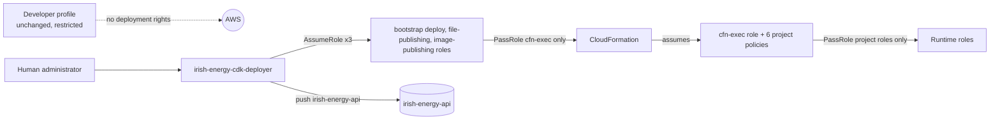

# Phase 9.7.2: AWS administrator preparation

Status: documentation and policy proposals only (hardened by Phase 9.7.2.1: see `docs/phase-9.7.2.1-boundary-hardening.md`). Nothing was deployed or bootstrapped, no AWS API was called, no credential
file was read, no role or policy was created, and no image was pushed. Pipeline execution is still disabled
(`PIPELINE_EXECUTION_ENABLED=true` still stops start-up) and the reconciler schedule is disabled by default. The existing
developer identity is unchanged. Baseline: commit `4fdd2fe` (Phase 9.7.1), account `851725545966`, region `eu-west-1`.

The policy documents are in `docs/iam/` (index and per-policy details in `docs/iam/README.md`). They were derived from the
synthesized templates of all eight stacks (generated offline with explicit `CDK_DEFAULT_ACCOUNT=851725545966` and
`CDK_DEFAULT_REGION=eu-west-1`), not invented. Anything that depends on the real account is marked unverified.

## 1. Summary

The goal is a separate, restricted deployment identity instead of widening the developer profile. The design uses the
standard CDK model with three tiers:

1. A human **deployer role** that can only assume three bootstrap roles, watch the project's stacks and push the API image.
2. The **bootstrap roles** (deploy, file-publishing, image-publishing) created by the administrator when bootstrapping.
3. A **CloudFormation execution role** whose permissions are the project's resource-scoped policies, not
   `AdministratorAccess` (the default for bootstrap) and not the deployer's own permissions.

Recommended verdict: the package is ready for administrator review. It is not ready to apply: the bootstrap state, the
qualifier and several generated resource names are unresolved, and policy completeness can only be proven by a supervised
deployment (section 13).

## 2. Deployment inventory and permission matrix

Eight stacks, all pinned to `aws://851725545966/eu-west-1`. The Pipeline Lambdas use a Docker image asset; the reconciler
Lambda uses a zip asset; everything else is plain CloudFormation.

| Stack | Resources (from the synthesized template) | Retained or protected | Exports (consumers) | Deployment permissions (policy file) |
|---|---|---|---|---|
| `IrishEnergyDataLakeStack` | Glue database `irish_energy_analytics`, Glue table `daily_electricity_demand`, Athena workgroup `irish-energy-analytics`. No S3 bucket: the data lake bucket pre-exists | none | none | Glue and Athena actions on exact ARNs (`cloudformation-execution-policy.json`) |
| `IrishEnergyApiRegistryStack` | ECR repository `irish-energy-api` (immutable tags, scan on push, lifecycle rules) | repository **Retain** | repository name and ARN (ApiEdge) | ECR create, tag and lifecycle actions, no delete (`cloudformation-execution-policy.json`) |
| `IrishEnergyRunHistoryStack` | DynamoDB table `irish-energy-run-history` (on-demand, `gsi1`, point-in-time recovery, SSE, TTL) | table **Retain** and deletion protection on | table ARN (Workflow, Reconciler, ApiEdge) | DynamoDB create, update, tag, no delete (`cloudformation-execution-policy.json`) |
| `IrishEnergyPipelineStack` | four Lambda functions (container image), four log groups `/aws/lambda/irish-energy-pipeline-*`, four roles and policies | log groups Delete | four function ARNs (Workflow) | `lambda-deployment-policy.json`, `passrole-policy.json`, IAM role actions |
| `IrishEnergyWorkflowStack` | state machine `irish-energy-pipeline` (STANDARD), one role and policy | Delete | state machine ARN | Step Functions actions, `passrole-policy.json` |
| `IrishEnergyReconcilerStack` (optional, `-c reconcilerEnabled=true`) | Lambda `irish-energy-run-reconciler` (zip), its log group, schedule `irish-energy-run-reconciler` (`DISABLED` unless the schedule context is set), two roles | log group Delete | none | Lambda, Scheduler, `passrole-policy.json` |
| `IrishEnergyApiEdgeStack` | VPC with two public subnets and no NAT, internet gateway, route tables, two security groups, S3 and DynamoDB gateway endpoints, internet-facing ALB (deletion protection on, HTTPS 1.2/1.3 listener, port 80 redirect), target group and rule, ECS cluster, Fargate service (one task), task definition, two roles, API log group | log group **Retain**, ALB deletion protection | none | `ecs-deployment-policy.json`, `network-deployment-policy.json`, `passrole-policy.json` |
| `IrishEnergyFrontendStack` | private encrypted S3 site bucket, bucket policy, CloudFront distribution (alias `energy.`), origin access control, response-headers policy | bucket **Retain** | none | **none in the general package**: a supervised session (section 14); optional exact-identifier update policy afterwards |

Deployment operations beyond the stacks:

| Operation | Performed by | Permission source |
|---|---|---|
| Publish the CloudFormation templates and the reconciler zip to the bootstrap S3 bucket | file-publishing role | bootstrap role (not in this package) |
| Build and push the pipeline Lambda image to `cdk-<qualifier>-container-assets-...` | image-publishing role | bootstrap role (not in this package) |
| Push the API image to `irish-energy-api` | deployer | `ecr-publishing-policy.json` |
| Submit, monitor, roll back stacks | deploy role, deployer for read-only | bootstrap deploy role, `deployment-identity-policy.json`, `rollback-policy.json` |
| Create the resources | CloudFormation execution role | the six execution policies |
| Upload the built frontend and invalidate CloudFront | **not covered** | needs a separate, separately approved procedure (finding H-6) |

## 3. Identity architecture



A. **Developer** (`irish-energy-data-platform-dev`): unchanged. It is not mentioned in any policy and is not given
`AssumeRole` on the bootstrap roles. `AdministratorAccess` is not recommended anywhere.

B. **Deployer** (`irish-energy-cdk-deployer`, proposed): `deployment-identity-policy.json`, `ecr-publishing-policy.json` and,
only when needed, `rollback-policy.json`. It cannot create or modify any resource itself, cannot read data, cannot invoke
Lambda or Step Functions, and cannot change `CDKToolkit*` stacks (explicit Deny). `iam:PassRole` is limited to the
CloudFormation execution role and only for `cloudformation.amazonaws.com`; in the normal CDK flow it is the bootstrap deploy
role that passes that role, so the statement matters only if the deployer calls CloudFormation directly.

C. **CloudFormation execution role**: separate from the deployer. See section 5.

D. **Runtime roles**: unchanged (section 8).

## 4. CDK bootstrap strategy

What the app expects (from the synthesized manifest, since Phase 9.7.4): default synthesizer, qualifier `energydev01`, bootstrap version 6 or
later, roles `cdk-energydev01-{deploy,file-publishing,image-publishing,cfn-exec}-role-851725545966-eu-west-1`, asset bucket
`cdk-energydev01-assets-851725545966-eu-west-1`, image repository `cdk-energydev01-container-assets-851725545966-eu-west-1`,
version parameter `/cdk-bootstrap/energydev01/version`. The application sets no custom synthesizer; the default bootstrap (`hnb659fds`) is not referenced.

**Can the energy project share the game's bootstrap?** Unknown; do not assume. Whether the game uses CDK, and with which
qualifier, is not recorded in this repository. If a bootstrap stack with the default qualifier already exists, then:

- Running `cdk bootstrap` for this project **would update the existing stack** and could change roles and policies the game
  depends on.
- The shared execution role defaults to `AdministratorAccess`. Narrowing it to this project's policies would break any game
  deployment that uses it; leaving it broad defeats this package.
- The bootstrap roles trust the account root, so any principal in the account with `sts:AssumeRole` permission can assume
  them. Sharing therefore also shares that exposure.

**Recommendation: a dedicated bootstrap**, if the administrator confirms it is compatible:

- Use the dedicated qualifier `energydev01` **and** the separate toolkit stack name `CDKToolkit-energydev01`. A different qualifier with the default stack name would still update the existing stack.
- Compatibility: the CDK reads the qualifier from the context key `@aws-cdk/core:bootstrapQualifier`, so a one-line context
  addition in `infrastructure/cdk.json` makes the app use it without code changes. **The context is set (Phase 9.7.4)** and tests
  check that every role, bucket and repository name in the synthesized manifest uses `energydev01`; the policies use it too.
- The default qualifier `hnb659fds` is not used by this project.

**Inspect the current state safely** (read-only; commands in section 10): describe `CDKToolkit*` stacks (status, tags, outputs and the `Qualifier` parameter, which is how existing qualifiers are found; SSM parameters cannot be listed with the general policy), read the version parameter of a known qualifier (`ssm:GetParameter` on its exact name), and read the trust
and permissions of the existing `cdk-*-role-*` roles.

**Bootstrap command** (for the administrator, **not run here**; always explicit so it can never target the default stack):

```bash
# 1. Review the template locally first (no AWS call expected):
cdk bootstrap --show-template > bootstrap-template.yaml   # compare with docs/iam/bootstrap/energydev01-bootstrap-template.yaml
# 2. Create the six project policies and the runtime boundary (docs/phase-9.7.2.1-boundary-hardening.md) as customer managed policies from docs/iam/ (administrator action), then:
CDK_DEFAULT_ACCOUNT=851725545966 CDK_DEFAULT_REGION=eu-west-1 \
cdk bootstrap aws://851725545966/eu-west-1 \
  --qualifier energydev01 --toolkit-stack-name CDKToolkit-energydev01 \
  --template docs/iam/bootstrap/energydev01-bootstrap-template.yaml \
  --cloudformation-execution-policies "arn:aws:iam::851725545966:policy/<cloudformation-execution>,arn:aws:iam::851725545966:policy/<lambda-deployment>,arn:aws:iam::851725545966:policy/<ecs-deployment>,arn:aws:iam::851725545966:policy/<network-deployment>,arn:aws:iam::851725545966:policy/<iam-role-management>,arn:aws:iam::851725545966:policy/<passrole>,arn:aws:iam::851725545966:policy/<cfn-exec-protection>" \
  --termination-protection
```

Never run `cdk bootstrap` without `--qualifier` and `--toolkit-stack-name`. The deployer's Deny on `CDKToolkit*` stacks also
protects the existing stack from deployer mistakes. Compare the output of `--show-template` with the existing stack before any
update (read-only `get-template`). I did not retrieve the bootstrap template.

**Bootstrap versus ordinary deployment permissions**

| Phase | Identity | Needs | Scope |
|---|---|---|---|
| Bootstrap (once, then only on upgrade) | a bootstrap administrator, separate from the deployer | CloudFormation, IAM, S3, ECR and SSM write access, which AWS documents as `cloudformation:*`, `ecr:*`, `ssm:*`, `s3:*` and `iam:*` | scope to the toolkit stack `CDKToolkit-energydev01/*`, parameter `/cdk-bootstrap/energydev01/*`, bucket `cdk-energydev01-assets-*`, repository `cdk-energydev01-container-assets-*` and roles `cdk-energydev01-*`; no other resource; never used for ordinary deployment |
| Ordinary deployment | deployer | `deployment-identity-policy.json`, `ecr-publishing-policy.json` | as in section 3 |
| Resource creation | CloudFormation execution role | six execution policies | section 5 |

Bootstrap-created resources the administrator should know: an S3 asset bucket (versioned, encrypted, lifecycle rules), an ECR
container repository (immutable tags), the four roles plus the CloudFormation execution role, and the version parameter. A
customer-managed KMS key exists only in older bootstrap versions; `--no-bootstrap-customer-key` avoids its fixed charge.

## 5. CloudFormation execution role analysis

Each statement is scoped by resource type:

| Need | Scope achieved | Limitation |
|---|---|---|
| Glue, Athena, ECR, DynamoDB, Step Functions, Scheduler | exact ARNs from the CDK code | `DeleteRepository` and DynamoDB `DeleteTable` are absent because both resources are retained; `glue:DeleteDatabase`, `glue:DeleteTable` and `athena:DeleteWorkGroup` are absent as well (section 14.8) |
| Five Lambda functions and log groups | exact ARNs | none |
| IAM roles (Phase 9.7.2.1) | exactly nine role-name patterns, only with `iam:PermissionsBoundary` equal to the project boundary, no managed-policy attachment, no boundary changes (`iam-role-management-policy.json`) | names have a random suffix; IAM cannot restrict the trust-policy principal; the boundary limits what the roles can do, not the execution role itself |
| ECS cluster and service | stack-name prefix | `RegisterTaskDefinition` has no resource-level support |
| EC2 networking | account and region, `aws:RequestTag/Project` on create, `aws:ResourceTag/Project` on manage and delete | describe actions have no resource-level support; the tag conditions rely on CDK stack tags reaching the resources (unverified) |
| ALB, target group, listeners | load balancer, listener and rule ARNs name the fixed load balancer `irish-energy-api` (Phase 9.7.2.2); target groups by `Project` tag condition | target group isolation depends on the tag condition (unverified); fails closed |
| S3 site bucket and CloudFront | **removed from the execution policy** (Phase 9.7.2.2); supervised deployment, section 14 | creation cannot be resource-scoped or tag-isolated, see section 14 |
| Task-definition deregistration | limited to the project family `IrishEnergyApiEdgeStackApiServiceTaskDefinition*` | if ECS does not support resource-level deregistration the statement fails closed and teardown needs a supervised step |

Not granted: any data-plane access (S3 objects, DynamoDB items), Lambda invocation, `states:StartExecution`, secrets, KMS,
Cognito, ACM, Route 53, other repositories, other accounts, or any resource of the game. The wrong-account safeguard from
Phase 9.7.1 also applies: synthesis stops unless `CDK_DEFAULT_ACCOUNT` is exactly `851725545966`.

## 6. ECR image publication

| Image | Repository | Path | Who | Permissions |
|---|---|---|---|---|
| Pipeline (shared by four Lambdas) | `cdk-<qualifier>-container-assets-851725545966-eu-west-1`, tag is the content hash (linux/amd64) | `cdk deploy IrishEnergyPipelineStack` builds the Docker image locally and the image-publishing role pushes it | bootstrap image-publishing role | defined by the bootstrap template (login, layer upload, `PutImage`); the deployer needs only `sts:AssumeRole` on it. The CloudFormation execution role needs pull access (`BatchGetImage`, `GetDownloadUrlForLayer`, `GetRepositoryPolicy`) to create the functions: in `lambda-deployment-policy.json` |
| API | `irish-energy-api` (created by the registry stack; tags immutable; scan on push) | built and pushed manually with an explicit version tag, before the edge stack is deployed | deployer | `ecr-publishing-policy.json` |

Manual API publication (documentation only, not run):

```bash
aws ecr get-login-password --region eu-west-1 | docker login --username AWS --password-stdin 851725545966.dkr.ecr.eu-west-1.amazonaws.com
docker build --platform linux/amd64 -t 851725545966.dkr.ecr.eu-west-1.amazonaws.com/irish-energy-api:v0.1.0 .
docker push 851725545966.dkr.ecr.eu-west-1.amazonaws.com/irish-energy-api:v0.1.0
```

The token is piped and never printed. `ecr:GetAuthorizationToken` cannot be scoped to a repository; the push actions are scoped
to `irish-energy-api` only. Repository discovery uses `ecr:DescribeRepositories` on that repository. Docker is required on the
administrator's machine.

## 7. PassRole analysis

Two separate delegations exist and are kept in separate policies:

| Passer | Passed role | Allowed service | Policy |
|---|---|---|---|
| Deployer (or the bootstrap deploy role) | CloudFormation execution role only | `cloudformation.amazonaws.com` | `deployment-identity-policy.json` |
| CloudFormation execution role | Lambda roles (`IrishEnergyPipelineStack-{Bronze,Silver,Gold,GlueRegistration}Role*`, `IrishEnergyReconcilerStack-Role*`) | `lambda.amazonaws.com` | `passrole-policy.json` |
| | ECS execution and task roles (`IrishEnergyApiEdgeStack-ApiServiceExecutionRole*`, `...ApiServiceTaskRole*`) | `ecs-tasks.amazonaws.com` | |
| | Step Functions role (`IrishEnergyWorkflowStack-StateMachineRole*`) | `states.amazonaws.com` | |
| | Scheduler invocation role (`IrishEnergyReconcilerStack-SchedulerRole*`) | `scheduler.amazonaws.com` | |

No statement uses `*` as the resource, none allows an administrator or bootstrap role to be passed, and each carries
`iam:PassedToService`. The patterns are prefixes because the roles are named by CloudFormation; the logical-id part
distinguishes the roles within a stack, so the scheduler role cannot be passed to Lambda and a Lambda role cannot be passed
to ECS. The deployer cannot pass any runtime role. `iam:AssociatedResourceArn` could tighten this further but was not used
because its support for these services was not verified.

## 8. Runtime role review (unchanged)

From the synthesized templates. No runtime role was modified and none gained any permission.

| Role | Permissions today | Observation |
|---|---|---|
| ECS task execution role | ECR pull on the API repository, `ecr:GetAuthorizationToken` (`*`, required), log stream writes to the API log group | minimal |
| ECS API task role | S3 `ListBucket` (prefix condition) and `GetObject` on `gold/eirgrid/daily_demand/*`; DynamoDB item actions and `Query` on `gsi1` for the run table; `states:StartExecution` on the state machine; `states:DescribeExecution` | `StartExecution` is held but unused while `PIPELINE_EXECUTION_ENABLED` is off and startup refuses it; the Phase 9.7.2.1 boundary denies it for every role until execution is separately approved, with no CDK change (`docs/phase-9.7.2.1-boundary-hardening.md`, section 4) |
| Step Functions role | DynamoDB `UpdateItem` and `DeleteItem` on the run table; `lambda:InvokeFunction` on the four pipeline functions | minimal |
| Bronze, Silver, Gold Lambda roles | log writes plus S3 `GetObject` on the previous layer prefix and `PutObject` on its own prefix | minimal |
| Glue registration role | log writes plus `glue:GetTable` and `glue:CreatePartition` on the catalog, database and table | minimal; unverified against Lake Formation |
| Reconciler Lambda role | log writes; `states:DescribeExecution`; DynamoDB `GetItem`, `UpdateItem`, `DeleteItem` and `Query` on `gsi1` | **no `StartExecution`**, confirmed by a test |
| Scheduler invocation role | `lambda:InvokeFunction` on the reconciler function only | minimal |

All of them trust their service principal with `aws:SourceAccount`; whether Lambda supplies that key is the open check H-3.

## 9. Deployment, rollback and deletion

**Order** (existing plan, handover steps): DataLake (after the existing-resource check), ApiRegistry, RunHistory, Pipeline, Workflow, optional Reconciler (schedule `DISABLED`), ApiEdge. The **frontend stack is not a normal deployment step**: creating it is a supervised administrator operation outside the general execution role (sections 14.1 and 14.1a). Deploy named stacks one at a time; never `--all`; review `cdk diff` first.

| Situation | Action | Permission |
|---|---|---|
| Create or update fails | CloudFormation rolls back automatically; read `DescribeStackEvents` (deployer monitoring) for the first `*_FAILED` resource and its reason. The general verifier uses `DescribeStacks` status reasons and `DescribeStackResources`; stack events for the verifier need `cloudformation-diagnostic-policy.json` (section 14.11) | deployer read-only monitoring |
| Update still running and unsafe | `CancelUpdateStack` (only valid while `UPDATE_IN_PROGRESS`) | `rollback-policy.json` |
| `UPDATE_ROLLBACK_FAILED` | `ContinueUpdateRollback`; skipping resources needs project-owner approval | `rollback-policy.json` |
| First create fails (`ROLLBACK_COMPLETE`) | the stack cannot be updated; it must be deleted before redeploying. For a **stateless** stack the deployer can delete it. For a **stateful** stack (data lake, registry, run history) deletion is explicitly denied and needs separate approval (section 9.1). Retained resources stay and can collide with a redeploy | `DeleteStack` on the four stateless stacks only |
| Teardown of a stateless stack | delete in reverse dependency order: ApiEdge, Reconciler, Workflow, Pipeline. The frontend stack only in a supervised session. **ApiEdge teardown can stop at the ECS task definition**: `ecs:DeregisterTaskDefinition` is limited to the project family and resource-level support is unverified, so if it fails closed the administrator deregisters the project revisions in a supervised step (do not widen the permission); the ALB deletion protection must be switched off first by an approved update | `rollback-policy.json` |
| First creation of `IrishEnergyDataLakeStack` fails after creating Glue or Athena objects | CloudFormation cannot delete them because the execution role has no `glue:DeleteDatabase`, `glue:DeleteTable` or `athena:DeleteWorkGroup`; the stack stops in a failed rollback state and needs **administrator cleanup**: with approval and read-only confirmation, delete only the objects that the failed attempt created, then delete the stack, which itself needs separate approval | none; deliberately not granted |
| Teardown of DataLake, ApiRegistry or RunHistory | **not granted by the policy documents**: `rollback-policy.json` explicitly denies `DeleteStack`. This is a deliberate policy choice, not a technical impossibility; a separately approved permission can lift it | none |

Resources that survive deletion and need a human decision (no automatic deletion is recommended or permitted):

| Resource | Protection | Note |
|---|---|---|
| `irish-energy-run-history` table | Retain, deletion protection, point-in-time recovery | must be switched off by an approved update; holds run records |
| `irish-energy-api` repository | Retain | images and tags remain |
| Frontend site bucket | Retain | contents must be emptied manually by the owner |
| API log group | Retain | retention is 30 days |
| ALB | `deletion_protection.enabled=true` | stack deletion fails at the ALB until an approved update disables it; this is deliberate |
| Pre-existing data lake bucket | not managed by CDK | never touched |

Exports couple the stacks: `IrishEnergyRunHistoryStack` (table) is imported by Workflow, Reconciler and ApiEdge;
`IrishEnergyApiRegistryStack` (repository) by ApiEdge; `IrishEnergyPipelineStack` (function ARNs) by Workflow. CloudFormation
refuses to delete or change an export while an importer exists, which is why the order above is reversed and why the stateful
stacks are excluded. The rollback policy grants actions only on four `IrishEnergy*` stacks (Pipeline, Workflow, Reconciler, ApiEdge) and explicitly denies `DeleteStack` for the three stateful stacks, the frontend stack and `CDKToolkit*`. It names no game resource; the `CDKToolkit*` Deny exists because a game bootstrap stack could share that name, which is unknown.

### 9.1 Failed first creation of stateful stacks, deletion approval and name collisions

| Stack | If the first creation fails | Consequence |
|---|---|---|
| `IrishEnergyDataLakeStack` | CloudFormation tries to roll back. It cannot delete the Glue database, table or Athena workgroup it created (no delete permission, section 14.8) | the stack stops in a failed rollback state; administrator cleanup of only the objects that attempt created, then a separately approved deletion of the stack |
| `IrishEnergyApiRegistryStack` | the repository `irish-energy-api` has a retain policy and stays | a redeploy fails with an already-exists error until the orphan is adopted or removed by an approved decision; images and the immutable tags stay |
| `IrishEnergyRunHistoryStack` | the table `irish-energy-run-history` has a retain policy and deletion protection and stays | the same collision; the table may already hold run records, so it is never deleted casually: deletion protection and point-in-time recovery are switched off only with approval |

Deleting any of these three stacks, including a `ROLLBACK_COMPLETE` one, needs **separate written approval**: the IAM policy documents do not
grant it and `rollback-policy.json` explicitly denies it (a policy choice that a separately approved permission can lift; AWS does not prevent it).
Retained resources can cause **fixed-name collisions on redeployment** (finding M-6) and require approved cleanup or an administrator decision to adopt
them; this package specifies no import procedure. Run the read-only name-conflict checks (section 10) before any redeploy.

## 10. Read-only verification checklist

**Scope note.** The read-only policy includes CDK bootstrap metadata: `CDKToolkit*` stack descriptions and the roles and role policies matching
`cdk-<qualifier>-*-role-851725545966-eu-west-1`, plus the bootstrap bucket settings and repository policy. If the qualifier is shared with the game
(for example the default), these reads include the game's bootstrap metadata. This is inspection only: nothing is written and the deployer policy denies
any change to `CDKToolkit*` stacks.


For the administrator, using the read-only identity. **None of these commands was run.** They return metadata only; none
prints a credential, secret value, key or token. Expected result is in brackets. Replace `<...>` with the value found by an
earlier step. Add `--profile <read-only profile>`.

| Check | Command | Expected |
|---|---|---|
| Account and region | `aws sts get-caller-identity --query Account --output text` and `aws configure get region` | `851725545966`, `eu-west-1` |
| Bootstrap qualifiers present | `aws cloudformation describe-stacks --query "Stacks[?starts_with(StackName,'CDKToolkit')].{N:StackName,S:StackStatus,Q:Parameters[?ParameterKey=='Qualifier'].ParameterValue}"` (the general policy grants neither `ssm:GetParametersByPath` nor `ssm:DescribeParameters`) | qualifier(s) of existing bootstrap stacks, possibly none |
| Bootstrap version | `aws ssm get-parameter --name /cdk-bootstrap/<qualifier>/version --query Parameter.Value --output text` | 6 or later |
| Bootstrap stacks | `aws cloudformation describe-stacks --query "Stacks[?starts_with(StackName,'CDKToolkit')].{N:StackName,S:StackStatus,T:Tags}"` | note names and tags |
| Bootstrap trust | `aws iam get-role --role-name cdk-<qualifier>-deploy-role-851725545966-eu-west-1 --query Role.AssumeRolePolicyDocument` | who may assume it |
| Bootstrap role policies | `aws iam list-role-policies --role-name <role>` and `aws iam list-attached-role-policies --role-name cdk-<qualifier>-cfn-exec-role-851725545966-eu-west-1` | is it `AdministratorAccess`? |
| Bootstrap repository policy | `aws ecr get-repository-policy --repository-name cdk-<qualifier>-container-assets-851725545966-eu-west-1` | Lambda pull statement present |
| Data lake bucket ownership | `aws s3api head-bucket --bucket irish-energy-data-platform-851725545966 --expected-bucket-owner 851725545966` | success |
| Bucket configuration | `aws s3api get-bucket-location`, `get-bucket-versioning`, `get-bucket-encryption`, `get-public-access-block`, `get-bucket-ownership-controls` with the same `--bucket` | as documented |
| Glue and Athena names | `aws glue get-database --name irish_energy_analytics`, `aws glue get-table --database-name irish_energy_analytics --name daily_electricity_demand`, `aws athena get-work-group --work-group irish-energy-analytics` | found means a conflict with the first deployment: decide before deploying |
| Certificates | `aws acm list-certificates --region eu-west-1` and `--region us-east-1` (names only), then `aws acm describe-certificate --certificate-arn <the energy certificate arn> --query "Certificate.{S:Status,D:DomainName,A:SubjectAlternativeNames,U:InUseBy}"` for the two energy certificates only (the policy names them as `REPLACE_API_CERT_ID` and `REPLACE_FRONTEND_CERT_ID`) | `ISSUED`, covers only the energy hostname, `InUseBy` empty |
| Cognito (client names and groups) | `aws cognito-idp list-user-pool-clients --user-pool-id <id>` (names and client IDs, no secrets) and `aws cognito-idp list-groups --user-pool-id <id>`; the pool ID comes from the Cognito owner's creation record, because the general policy does not list pools (`ListUserPools` returns a summary of every pool, including trigger settings). Pool configuration (`describe-user-pool`) is in `cognito-inspection-policy.json` and needs explicit administrator approval (section 14.11). The app client is not inspected with this policy: section 14.7 | groups `viewer` and `operator`; client IDs match the configuration |
| DNS | `aws route53 list-hosted-zones-by-name --dns-name ai-autofy-general-server.com` (zone IDs and record counts), then `aws route53 get-hosted-zone --id <zone>` for the energy zone only (`REPLACE_HOSTED_ZONE_ID`, not yet known). Listing the records (`aws route53 list-resource-record-sets`) needs `dns-inspection-policy.json` with explicit administrator approval (section 14.11) | the zone exists; after an approved record listing, no existing `energy.` or `energy-api.` record and the game's records left alone |
| CloudFront alias and existing policies | **not in the general read-only policy.** Listing distributions returns every distribution's origins, including custom origin headers that can hold secrets. The alias, origin access control and response headers policy pre-checks belong to the supervised frontend session (section 14.1) | no distribution with the alias |
| Deployment role availability | `aws iam get-role --role-name cdk-<qualifier>-deploy-role-851725545966-eu-west-1` (and the file, image and cfn-exec equivalents) | exist after bootstrap |
| Service quotas | `aws service-quotas list-service-quotas --service-code vpc --query "Quotas[?QuotaName=='VPCs per Region']"`; likewise `elasticloadbalancing` (Application Load Balancers per Region), `fargate` (On-Demand vCPU), and `cloudfront` in `us-east-1` (distributions) | headroom for one more |
| Resource-based policies (bypass check, Phase 9.7.2.2) | `aws s3api get-bucket-policy --bucket irish-energy-data-platform-851725545966`; `aws ecr get-repository-policy --repository-name irish-energy-api` (and the bootstrap repository); `aws lambda get-policy --function-name irish-energy-pipeline-bronze` (each of the five); `aws dynamodb get-resource-policy --resource-arn <table arn>` | no grant naming a project role ARN beyond the runtime design |
| Name conflicts |  `aws dynamodb describe-table --table-name irish-energy-run-history`; `aws ecr describe-repositories --repository-names irish-energy-api`; `aws stepfunctions list-state-machines --query "stateMachines[?name=='irish-energy-pipeline']"`; `aws scheduler get-schedule --name irish-energy-run-reconciler`; `aws logs describe-log-groups --log-group-name-prefix /aws/lambda/irish-energy`; `aws cloudformation list-stacks --query "StackSummaries[?starts_with(StackName,'IrishEnergy')].[StackName,StackStatus]"`; `aws elbv2 describe-load-balancers --query "LoadBalancers[].LoadBalancerName"` (the name `irish-energy-api` must be unused); `aws ecs list-clusters` | `ResourceNotFound` or empty is the expected result |

### 10.1 Inspecting Lambda configuration and resource policies without exposing secrets

- **Resource policies** (needed for the bypass check in section 14.5): `aws lambda get-policy --function-name <one of the five names> --query Policy --output text`
  with the general read-only identity. The output is a policy document (principals, actions, conditions), not a secret.
- **Configuration** (runtime, role, memory, state, environment variable *names*) is **not** readable with the general policy.
  Before deployment, compare the reviewed `cdk diff` and the synthesized template: the project functions carry only non-secret
  settings (`S3_BUCKET`, `RUN_HISTORY_TABLE`, `PIPELINE_STATE_MACHINE_ARN`). After deployment, if the configuration must be checked, a separately
  authorised identity chosen by the administrator may call `aws lambda get-function-configuration` for one named function with a `--query` that selects
  only non-secret fields (for example state, role, memory, timeout and `keys(Environment.Variables)` for names only). `--query` is **not** a security
  boundary: the full response, including variable values, still reaches the client, so do not redirect it to a file, a log or a ticket, and prefer the console.
- **Never use `aws lambda get-function`**: its response includes a presigned URL to download the deployment package and the environment values.
- **Existence of a function name** cannot be confirmed with the general policy (`GetPolicy` returns the same not-found error for a missing function and for
  an existing function without a resource policy). `logs:DescribeLogGroups` with the prefix `/aws/lambda/irish-energy` shows only log groups of
  functions that have run. If the name is already used, the first CloudFormation creation of that stack fails with an already-exists error
  and overwrites nothing; this is confirmed in the supervised deployment, or earlier by the separately authorised identity.

## 11. Cost, boundaries and what stays disabled

Prices are not restated here; the estimates in section 11 of `docs/phase-9.7-production-readiness.md` are from memory and
unverified.

- **Fixed charges while deployed:** the Application Load Balancer, the Fargate task (running continuously), public IPv4
  addresses (the ALB nodes and the task), and the retained resources' storage. A deployed but unused edge stack still costs.
- **Usage-dependent:** CloudFront and data transfer, Lambda invocations, Step Functions transitions, DynamoDB on-demand
  requests and point-in-time recovery storage, CloudWatch Logs ingestion and storage, ECR storage, S3 requests, Athena bytes
  scanned (capped at 10 MB per query by the workgroup).
- **NAT gateway:** none is used (public subnets, tasks with public IPs). Adding one creates a per-hour charge per gateway plus
  a per-gigabyte processing charge, and is a separate decision (finding H-2).
- **One ECS task initially:** controls cost, and the API rate limiter is in memory per task (finding M-5). A rolling deploy
  temporarily runs two (minimum healthy 100 percent, maximum 200 percent); the circuit breaker rolls back a failing deployment.
- **Reconciler schedule disabled:** enabling it mutates run history every five minutes and is part of the separate
  activation after pipeline verification.
- **Pipeline execution disabled:** the API refuses to start with `PIPELINE_EXECUTION_ENABLED=true`, no policy here grants
  `StartExecution` or Lambda invocation, and no execution is part of deployment.

| The administrator may deploy (after `cdk diff` review, one stack at a time) | Requires separate written approval |
|---|---|
| Stacks in the section 9 order with the schedule `DISABLED`, except the frontend stack | bootstrap or any change to an existing bootstrap; the frontend stack (supervised session, section 14) |
| Pushing the API image with an explicit tag | issuing or changing ACM certificates, Route 53 records, Cognito |
| Rollback and deletion of stateless stacks | enabling the reconciler schedule or pipeline execution |
| Read-only verification | adding a NAT gateway, WAF or alarms; uploading the frontend and invalidating CloudFront |
| | deleting any retained resource or stateful stack; `--all`; any change to the game's resources or to the developer identity |

## 12. Validation

Offline validation results are in the final report and are reproducible, but they are results of local models and the synthesized templates, not of AWS; effective permissions are confirmed only during supervised deployment (section 14.9). The checks are: the five IAM policy test files `tests/test_iam_policy_package.py`, `test_iam_boundary.py`, `test_iam_isolation.py`, `test_iam_readonly_secrets.py` and `test_iam_inspection_policies.py` (policy structure, wildcards, PassRole, action names, boundary, isolation, read-only scope, resource names against the synthesized templates), the existing infrastructure
tests (runtime roles, no `StartExecution` for the reconciler, schedule default `DISABLED`, execution flag), the frontend
tests, build and lint, and the five synthesis configurations. No AWS API was called.

## 13. Remaining items for administrator review

0. Decisions that must be made and recorded: the identity that carries the temporary frontend permissions (section 14.1a); the approval path
   and the cleanup procedure for failed first creation of the stateful stacks (section 9.1); how retained-resource name collisions are resolved.

1. The bootstrap decision (section 4) and the qualifier `energydev01` (already applied).
2. Resolve the unverified conditions and generated-name patterns (`docs/iam/README.md`, section 4), by a supervised first
   deployment of the smallest stacks, then the edge stack.
3. IAM role creation is now limited to nine named roles that must carry the runtime permissions boundary (Phase 9.7.2.1). The boundary must be created by the administrator, and the application must be told to use it before the first deployment.
4. Frontend upload and CloudFront invalidation are covered only by the optional `frontend-publishing-policy.json`, with placeholders for the bucket and distribution.
5. The open Lambda trust condition (H-3). The `StartExecution` statement is neutralised by the boundary until the separate activation.
6. Existing Critical findings C-1 to C-3 and High findings H-1 (plaintext key file, owner action) to H-5 remain open.

## 14. Phase 9.7.2.2: isolation review

Offline review of the whole package against the question "can this reach the existing game?". No AWS call was made. The
service authorization tables could not be fetched here, so resource-level and condition-key support below comes from the AWS
documentation that could be read, from the synthesized templates and from general service behavior; every scoping that depends
on an unverified condition **fails closed** (an AccessDenied during the first supervised deployment, never a wider grant).
Do not widen a pattern to make a deployment succeed: use the supervised procedure instead.

### 14.1 CloudFront (critical, resolved by removal)

| Item | Finding |
|---|---|
| Resource-level permissions | distributions, origin access controls and response headers policies have ARNs with generated identifiers (`distribution/<ID>` and so on), so no pattern can be narrower than the account before the resources exist |
| Tag conditions | the CloudFront IAM documentation states ABAC support is only partial, for resource types that support tags such as distributions. Origin access controls and response headers policies are not taggable. Distribution creation can only be tag-conditioned for the tagged-creation variant, which was not verified to be what CloudFormation calls |
| Isolation | **not demonstrable**: the previous `distribution/*`, `origin-access-control/*` and `response-headers-policy/*` patterns could update or delete the game's distribution, origin access control or response headers policy |
| Decision | all CloudFront permissions and the site-bucket permissions were **removed from the general execution policy**; the frontend stack is deployed by a supervised procedure |

Supervised procedure (account owner, separately approved, time-boxed):

1. Read-only pre-checks, performed by the supervised session's own identity and not by the general read-only policy: no distribution with the alias `energy.ai-autofy-general-server.com`; list existing origin access
   controls and response headers policies so new ones can be told apart; the `us-east-1` certificate is issued and covers only the
   energy hostname.
2. `cdk diff IrishEnergyFrontendStack` with explicit `CDK_DEFAULT_ACCOUNT` and `CDK_DEFAULT_REGION`: only creations, no
   change to any existing resource.
3. A temporary, separately approved permission set limited to the create and tag actions that stack needs, carried by the identity chosen in section 14.1a (an administrator decision that is **not yet made**). It is not part of this package and must not be reused; it is removed or detached after the session.
4. Deploy only `IrishEnergyFrontendStack` by name, never `--all`. CloudTrail is reviewed afterwards for calls on any resource
   other than the four new ones.
5. Record `SiteBucketName`, `DistributionId` and the identifiers of the origin access control and response headers policy.
6. For later updates, attach `frontend-stack-update-policy.json` (exact identifiers, no create, no delete) for one approved
   update. Site uploads and invalidations use `frontend-publishing-policy.json`. Deletion of the stack is supervised too.

### 14.1a Which identity carries the temporary frontend permissions (administrator decision required)

The repository does not establish this. The CDK application uses the default synthesizer, so CloudFormation assumes the bootstrap
CloudFormation execution role for every stack, including `IrishEnergyFrontendStack`. No separate CloudFormation service role is defined in the
CDK configuration, none is documented as existing, and `deployment-identity-policy.json` allows passing only the execution role. Two options exist;
neither is implemented or presumed here.

| Option | What carries the permissions | Isolation implications |
|---|---|---|
| A. Temporarily widen the execution role | a separately approved policy with the create and tag actions of the frontend stack is attached to the CloudFormation execution role for the session and detached afterwards | while attached, the role used for every deployment can act on CloudFront resources account-wide, so IAM does not isolate the game's distributions. Protection is procedural: time-boxed, no other stack deployed meanwhile, `cdk diff` showing creations only, CloudTrail review. A failure to detach leaves the broad permission in place |
| B. A separate CloudFormation service role for this stack | a new role trusting `cloudformation.amazonaws.com` with the temporary permissions, created by the IAM administrator and passed only for this stack (for example with the CDK CLI `--role-arn` option) | the general execution role stays narrow and the broad permission exists only in the new role. It needs administrator work this package does not contain: creating the role, a narrow `iam:PassRole` to it for the deployer or the bootstrap deploy role (the current policy passes only the execution role), and a supervised check of the CLI path. The role is removed or emptied after the session. IAM still cannot scope CloudFront creation to this project, so isolation remains procedural during the session |

**Administrator decision required before frontend creation:** choose A or B, record the choice, and confirm the implementation, including the
detachment or removal, in the supervised session. Until then the frontend stack must not be deployed.

### 14.2 Elastic Load Balancing (critical, resolved by naming)

The edge stack did not set a load balancer name, and a name generated by CloudFormation is not predictable. Listeners and
listener rules cannot be tagged through CloudFormation, so a tag condition could not isolate them. The load balancer now has the
fixed name `irish-energy-api` (one line in `infrastructure/stacks/energy_edge_stacks.py`, the only application change in this
phase; it is necessary because the permissions could not otherwise be tied to this load balancer). The listener, rule and load
balancer statements now use `loadbalancer/app/irish-energy-api/*`, `listener/app/irish-energy-api/*/*` and
`listener-rule/app/irish-energy-api/*/*/*`. A test checks that none of these patterns matches a game-style load balancer, listener or rule ARN and that the
synthesized template has exactly that name. Target groups keep the `Project` tag conditions (CloudFormation tags them); they are
generated names, so their isolation depends on the tag. Describe actions are account-wide read-only metadata. A fixed name means a
property that requires replacement cannot be updated in place; no such change is planned. Confirm the name is unused first.

### 14.3 Trust-policy updates (high, resolved by removal)

CloudFormation calls `iam:UpdateAssumeRolePolicy` only when a role's trust policy changes in an update, never when it creates a
role. It is therefore removed from `iam-role-management-policy.json`. `iam-trust-update-policy.json` holds it for the nine role
patterns and is attached only for one approved change. Remaining risk: IAM has no condition for the principal in a trust policy, and the
permissions boundary does not limit who may assume a role, so a reviewed `cdk diff` is the only control. The handover requires
review of every runtime-role trust-policy change.

### 14.4 Other checks

| Check | Result |
|---|---|
| `logs:DescribeLogGroups` | the CloudWatch Logs permissions reference documents it as "view all log groups associated with the account"; no per-group authorization is documented. The previous special ARN form could not be confirmed, so the statement is now `Resource: *` and named `DescribeLogGroupsAccountWideReadOnly`. It is an account-wide, read-only metadata call (it lists game log group names, never contents) |
| EC2 | every create carries `aws:RequestTag/Project`, every change or delete `aws:ResourceTag/Project`, tagging is limited to resource creation by `ec2:CreateAction`, describe actions are read-only. The tag conditions are unverified against AWS and fail closed. They isolate only if no game resource carries `Project=irish-energy-data-platform` |
| ECS | `RegisterTaskDefinition` and `DescribeTaskDefinition` have no resource-level support. `DeregisterTaskDefinition` was narrowed to the project family. A registered task definition can only use a project role because `iam:PassRole` is limited to the project roles |
| Read-only policy | the only function-level read is `lambda:GetPolicy` on the five project function names (resource policies, no secrets); `lambda:GetFunction` and `lambda:GetFunctionConfiguration` are **not granted** because they return environment variable values and, for `GetFunction`, a presigned URL to the deployment package; the rest are list or describe calls |
| Wildcard resources | every `*` resource is a read-only action or an action without resource-level support (login token, caller identity, task-definition registration); a test checks that none of the other patterns matches a set of plausible game resources |
| `states:StartExecution` | the initial boundary denies it for every runtime role; the activation variant allows it only for the API task role (tests for all nine roles) |

### 14.5 Resource-based policies and the boundary

A permissions boundary limits identity-based permissions of the role. Per AWS policy-evaluation rules, a resource-based policy
that names a role's ARN directly can grant access the boundary does not limit (confirm against the current IAM documentation).
Candidates in this design, all to be inspected read-only before deployment:

| Resource | Why it matters |
|---|---|
| Data lake bucket policy (pre-existing, unknown) | could grant a project role (or its `root` or `*` principal) access outside its prefix |
| `irish-energy-api` and bootstrap repository policies | could grant pull or push to named roles; the bootstrap repository legitimately allows Lambda pull |
| Lambda function policies, DynamoDB resource policy | none are created by this CDK application; an existing one could name a role |
| Role trust policies | the permissions boundary does not constrain them (section 14.3) |
| Site bucket policy | grants the CloudFront service principal only; created by the supervised deployment |

Remove any grant to a project role ARN that the runtime design does not need.

### 14.6 Remaining limitations

- Condition keys and resource-level behavior listed above are not verified in AWS; the first supervised deployments confirm them.
- Target group and EC2 isolation relies on the `Project` tag.
- CloudFront creation remains a supervised, human-controlled action whose permission set is outside this package.
- The execution role can still deregister only the project task definition family, and delete only the nine named roles.

### 14.7 Correction: client secrets and other sensitive reads

`cognito-idp:DescribeUserPoolClient` can return the app client's `ClientSecret`, and filtering the output with `--query` is not a security
boundary: the full response is delivered to the caller and only the display is filtered, so an IAM grant is a grant to read the
secret. The action was removed from the general read-only policy and from every other policy in the package (a test checks all
documents).

- Retained Cognito access, scoped to the energy pool only: `ListUserPoolClients` (client names and IDs, no secret) and `ListGroups`. `ListUserPools` and `DescribeUserPool` left the general policy in Phase 9.7.2.3 (section 14.11).
- Inspecting the energy app client (redirects, flows, scopes, and that it has no secret) is done **separately**, by the pool's owner
  with a separately authorised identity that has `DescribeUserPoolClient` on that one user pool only, outside this package. The
  administrator must never print, log, paste or record the response: prefer the Cognito console (it shows whether a secret
  exists without displaying it) or a command that selects only non-secret fields and is not redirected to a file or captured in
  shell history. The energy client is meant to be a public client with no secret, so there should be nothing to disclose, and a
  secret on it is itself a finding.
- A review of every other read-only statement removed the calls that expose other applications' sensitive configuration:

| Removed or narrowed | Why |
|---|---|
| `iam:ListRoles` | returns every role's trust policy, which can include external IDs of other applications |
| `cloudformation:ListExports` | returns the export values of all stacks |
| `cloudfront:ListDistributions` and the OAC and response headers lists | distribution summaries include origin custom headers; moved to the supervised session |
| `ssm:DescribeParameters` | lists every parameter name in the region; **not replaced**: `ssm:GetParametersByPath` was removed as well, only `ssm:GetParameter` on the exact bootstrap version parameter remains, and qualifiers are found from the `CDKToolkit*` stack parameters |
| `acm:DescribeCertificate` on `*` | shows `InUseBy` resources of other applications; now only the two energy certificates (placeholders) |
| `route53:GetHostedZone` and record listing on `*` | `GetHostedZone` only on the energy hosted zone (placeholder); record listing moved to `dns-inspection-policy.json` |
| `s3:ListBucket` on the bootstrap asset bucket | could list another project's assets when a bootstrap is shared; configuration reads remain |
| Cognito pool description on `*` | now only the energy user pool (placeholder) |

What remains with `Resource: *` is a list of names or generic metadata (account identity, stack names, user pool and certificate
names, hosted zone lookup by name, state machine and cluster names, log group names, load balancer and VPC descriptions, service
quotas). Those reveal that other applications exist and their names, not their secrets. The `DescribeUserPool` output for the energy pool (which can include SMS and Lambda trigger configuration) is sensitive but limited to this project.

### 14.8 Correction: Glue and Athena deletion

`glue:DeleteDatabase` and `glue:DeleteTable` are not required by the planned lifecycle. Creation and update need only `Create*`,
`Get*` and `Update*`. Deleting the data lake stack is an explicit Deny in the rollback policy (it is a stateful stack and the Gold
table must not disappear with a routine action), and a replacement of the table or database is not planned. They were removed
without adding anything else. For consistency `athena:DeleteWorkGroup` was removed on the same reasoning. Consequence: a failed
creation of `IrishEnergyDataLakeStack` that created Glue or Athena objects cannot be rolled back by CloudFormation and needs administrator
cleanup of only those objects (see section 9); deletion of the stack later needs a separately approved policy.

### 14.9 What the offline checks do and do not show

The tests (`tests/test_iam_policy_package.py`, `test_iam_boundary.py`, `test_iam_isolation.py`, `test_iam_readonly_secrets.py`, `test_iam_inspection_policies.py`) use local models of IAM
pattern matching, the synthesized templates, botocore operation names and **invented** game resource names. The game's real resources, DNS records and
deployment configuration have not been inspected and remain out of scope. Pattern-level results show how the documents are written, not what
AWS will authorise. **Effective permissions, including every unverified condition listed in `docs/iam/README.md` section 4, are confirmed only during
supervised deployment.**

### 14.10 Review of the remaining general verification permissions

Every action of `read-only-verification-policy.json` was reviewed for credentials, application secrets and deployment-package contents. Nothing in it
can read an object, an image layer, a function package, a parameter value other than the bootstrap version, a secret or a key.

| Group | Conclusion |
|---|---|
| `sts`, `servicequotas`, list calls (`ListStacks`, `ListCertificates`, `ListHostedZonesByName`, `ListStateMachines`, `ListClusters`, load balancer and VPC descriptions, `DescribeLogGroups`) | names and generic metadata only |
| `ssm:GetParameter` on `/cdk-bootstrap/<qualifier>/version` | the value is a version number; no listing, no other parameter |
| CloudFormation on `CDKToolkit*` and the eight project stacks | `DescribeStacks` (parameters, outputs and tags; `NoEcho` values are masked), `DescribeStackResources`, `ListStackResources`, `GetTemplate` (template text only). `DescribeStackEvents` events can carry resource properties, which for the project stacks are the non-secret settings in the templates; if a shared bootstrap stack belongs to the game, they are its bootstrap properties (inspection only) |
| `iam:GetRole`, `GetRolePolicy`, `ListRolePolicies`, `ListAttachedRolePolicies` on `cdk-<qualifier>-*` and `IrishEnergy*` roles | trust and permission policies, which hold no secret values; they may contain external IDs only if the template put them there (the project roles have none) |
| `s3` bucket-setting reads, `ecr` repository and policy reads, `glue`, `athena`, `dynamodb:DescribeTable` and `GetResourcePolicy`, `lambda:GetPolicy`, `states:DescribeStateMachine`, `scheduler:GetSchedule` | metadata and policies of project resources; no objects, no image layers (`BatchGetImage` and `GetDownloadUrlForLayer` are not granted), no items, no function configuration |
| `acm:DescribeCertificate` (two certificates) | certificate metadata; no private key, no export |
| `cognito-idp` (energy pool only) | client names and groups only; `DescribeUserPool` moved to `cognito-inspection-policy.json` |
| `route53:GetHostedZone` and `ListResourceRecordSets` (energy zone) | returns every record in the shared zone, including the game's `api.` and `play.` records and any TXT values. IAM cannot filter reads by record name. DNS data is public by nature, but this is a remaining limitation |

Remaining limitations: the items marked above, plus unverified AWS behavior as in `docs/iam/README.md` section 4. Tests check the policy text only
and show nothing about what AWS returns.

### 14.11 Separate inspection policies (Phase 9.7.2.3)

`route53:ListResourceRecordSets`, `cloudformation:DescribeStackEvents` and `cognito-idp:DescribeUserPool` were reviewed to decide whether routine
verification needs them. None is required for routine verification, so each moved into its own policy, attached to a separate role only for one approved
inspection. Each needs **explicit administrator approval** before attachment. **Read-only is not the same as safe:** these calls can disclose information even though
they change nothing.

| Policy | Action and scope | Why separate and what it exposes | Routine alternative in the general policy |
|---|---|---|---|
| `dns-inspection-policy.json` | `route53:ListResourceRecordSets` on `arn:aws:route53:::hostedzone/REPLACE_HOSTED_ZONE_ID` | IAM cannot restrict this call to individual record names, so it returns **every record in the shared zone**, including the game's `api.` and `play.` records and any TXT values. The hosted-zone ID is not known from the repository, so it stays a placeholder and no ARN was invented | `ListHostedZonesByName` and `GetHostedZone` on the energy zone |
| `cloudformation-diagnostic-policy.json` | `cloudformation:DescribeStackEvents` on the eight `IrishEnergy*Stack` ARNs (stack resources support resource-level scoping; `CDKToolkit*` stacks are not included) | events contain resource properties and status reasons that can include configuration values. IAM does not prevent sensitive information from appearing in event messages | `DescribeStacks` (status and reason), `DescribeStackResources` |
| `cognito-inspection-policy.json` | `cognito-idp:DescribeUserPool` on `arn:aws:cognito-idp:eu-west-1:851725545966:userpool/REPLACE_USER_POOL_ID` | the pool description can reveal SMS configuration (SMS role and external ID) and Lambda trigger settings. No client secret, user, authentication or modification permission is granted | `ListUserPoolClients`, `ListGroups` on the energy pool |

Additional finding: `cognito-idp:ListUserPools` was removed from the general policy because each pool summary it returns can include the pool's Lambda trigger
configuration, and it covers every pool in the region, including the game's. The energy pool ID is taken from the owner's creation record.
The deployer keeps `cloudformation:DescribeStackEvents` on the project stacks, because deployment monitoring needs it.

Safe use means: read the JSON first, attach for one named purpose after approval, run only the one matching command for the one named resource, do not save, paste
or ticket the output, and detach afterwards. The scoping, the response contents and the condition behavior are **unverified until separately authorised testing**; the tests only inspect the policy text.
