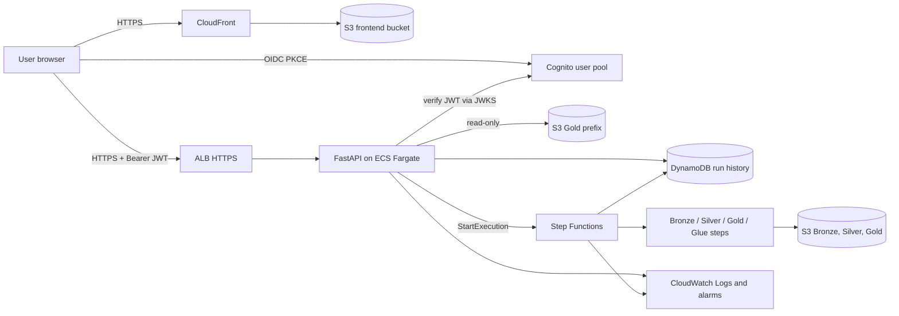

# Security review and production architecture plan

Status: review only. Nothing described here has been implemented or deployed.
No AWS API calls, pipeline runs or `POST /api/runs` requests were made while
writing it; findings come from reading the repository.

## 1. Current security findings

Scope: `src/api.py`, `src/run_store.py`, `src/analytics.py`, `frontend/src`,
`infrastructure/`, `.gitignore`, `requirements-api.txt`, `README.md`. There is
no Dockerfile, no environment example file and no root `requirements.txt`.

| Area | Finding |
|---|---|
| Authentication | None. Every endpoint is public: `/health`, `/api/runs`, `/api/runs/{id}`, `/api/analytics/daily-demand`, `POST /api/runs`, plus FastAPI's default `/docs`, `/redoc` and `/openapi.json`. |
| `POST /api/runs` | Unauthenticated. Any caller that can reach the port starts a real pipeline in a background thread using the API process's AWS identity: it fetches from EirGrid, writes Bronze, Silver and Gold to S3, and attempts Glue registration. |
| CORS | `allow_origins` is two hard-coded localhost origins, `allow_credentials=False`, methods `GET`/`POST`, header `Content-Type`. Reasonable for local development. CORS is a browser rule, not authentication: `curl`, scripts, other local processes and DNS-rebinding bypass it, and it never stops a request reaching the server. It must be tightened to the real frontend origin and must not be relied on for protection. |
| Error exposure | Tracebacks are not stored or returned (the traceback goes only to the server log). Storage errors return a generic 503. Analytics errors return only the AWS error code. The run `error` field returns `ExceptionClass: message`, truncated to 300 characters, with AWS key IDs and secret-like text redacted by regex. This is best-effort; messages can still contain bucket names, URLs or internal detail. |
| Information disclosure | The analytics response includes `source` (`s3://<bucket>/<prefix>`), and runs include S3 keys, stage and error text. All of it is readable without authentication. |
| Validation | Good: `days_back` 1-30 and `days` 1-90 are validated; `run_id` is only used in parameterized SQL; update fields are whitelisted. No request-body size limit beyond the server default. |
| Rate limiting | None. `GET /api/analytics/daily-demand` reads S3 on a cache miss; the 300 s cache is per `days` value, so up to 90 distinct keys can each trigger a read per TTL window. |
| Concurrent runs | Good: the single-active-run check and insert are one `BEGIN IMMEDIATE` transaction (also safe across processes). Gaps: no maximum run age, so a stuck run blocks new runs until restart, and the guard says nothing about who may start a run. |
| Run execution | In-process daemon thread. A restart kills it; startup recovery marks it `interrupted`. Acceptable locally, not for a managed service. |
| SQLite | `.local/` and `*.sqlite3*` are git-ignored. The file is created with default permissions (no explicit `0600`), is unencrypted, and holds S3 keys and error text. Single-process only. |
| Secrets in repo | `aws-access-key.txt` and the SSH key file are git-ignored, untracked and absent from git history (checked with `git ls-files`/`git log`, contents not read). A plaintext access-key file still exists in the working directory. `frontend/.env.development.local` is ignored by `*.local`. |
| Debug/dev settings | Hard-coded localhost CORS; docs endpoints on; README tells the user to bind `127.0.0.1` (binding `0.0.0.0` would expose an unauthenticated pipeline trigger); no HTTPS, security headers or access logging. |
| Dependencies | `requirements-api.txt` lists only `fastapi` and `uvicorn[standard]`, unpinned. The API also needs `boto3`, `pandas`, `pyarrow` and `requests`, which are not declared for the API. Builds are not reproducible. |
| Frontend | No `dangerouslySetInnerHTML`, `innerHTML`, `eval` or `localStorage` use; React escapes API data. Only the one `GET` request pattern per endpoint; the Run Pipeline button never calls the API. The CSS imports Google Fonts at runtime, a third-party request that complicates a strict Content-Security-Policy. |

## 2. Risks ranked by severity

Severity assumes the current code is exposed beyond localhost.

1. **Critical - unauthenticated pipeline trigger.** Anyone can cause S3 writes, outbound requests and cost, repeatedly (one at a time, but back to back).
2. **High - no authentication or authorization model.** All data, run history, bucket name and S3 keys are public.
3. **High - runtime AWS identity scope unknown.** If the deployed task inherits broad permissions, a bug in the API reaches them. The role must be scoped before deployment.
4. **Medium - no rate limiting or abuse controls** on S3-backed reads and on the trigger.
5. **Medium - run history not shared or durable** (SQLite on ephemeral storage); stuck runs cannot be cleared without a restart.
6. **Medium - best-effort error redaction** can still leak internal detail through the `error` field.
7. **Medium - unpinned, incomplete API dependencies.**
8. **Low - API docs enabled, no security headers/CSP, plaintext key file on disk, SQLite file permissions, runtime third-party font import.**

Not a risk today: the Run Pipeline button is a local demonstration and calls nothing.

## 3. Recommended authentication

A minimal design: **Amazon Cognito user pool + OAuth 2.0 authorization code flow with PKCE**, JWT bearer tokens, and group-based authorization in FastAPI. No custom user database and no session cookies.

**Frontend**
- Cognito app client for a public SPA (no client secret), authorization-code grant, PKCE, callback and sign-out URLs set to the CloudFront domain.
- Use the Cognito hosted UI so no password handling lives in the app. A small OIDC library (for example `oidc-client-ts`) handles PKCE and refresh.
- Keep tokens in memory; do not use `localStorage`. Send `Authorization: Bearer <access_token>` on every API call. The frontend currently makes plain `fetch` calls, so this is a small wrapper change.
- Self-sign-up disabled; users are created by an administrator.

**FastAPI**
- A dependency verifies the JWT on every protected route: RS256 signature against the pool's JWKS (`https://cognito-idp.eu-west-1.amazonaws.com/<pool-id>/.well-known/jwks.json`, cached), `iss`, `exp`, `token_use == "access"` and `client_id`. `PyJWT[crypto]` with `PyJWKClient` is enough.
- Missing, expired or invalid token: `401` with `WWW-Authenticate: Bearer`. Valid token without the required group: `403`.
- Configuration (pool ID, client ID, region) comes from environment variables; none are secrets.

**Authorization (separate read and execute)**
- Cognito groups, read from the `cognito:groups` claim: `viewer` for `GET` analytics and run history, `operator` for `POST /api/runs`. Operators also get MFA required.
- `/health` stays public for load-balancer checks and returns nothing sensitive.
- The trigger endpoint additionally gets: a per-user rate limit, recording of the caller's `sub` on the run record for audit, and in production a decoupled execution path (Section 4) so the API role holds only `states:StartExecution`, not pipeline write access.

**CORS, HTTPS and secrets**
- CORS: exact CloudFront origin only; methods `GET`, `POST`; headers `Authorization`, `Content-Type`; `allow_credentials=False` (bearer tokens, not cookies). Remember CORS only controls browsers; the JWT check is the control.
- HTTPS everywhere: CloudFront viewer protocol HTTPS-only; HTTPS listener on the load balancer with an ACM certificate and a modern TLS policy, port 80 redirected; HSTS header.
- Secrets: the API needs none. AWS access comes from the ECS task role, never static keys. Anything secret later goes in Secrets Manager or SSM Parameter Store, injected at runtime. Disable `/docs`, `/redoc` and `/openapi.json` in production.

Do not add a shared API key or any "optional" auth flag as an interim measure; a partial scheme would look like protection without being it.

## 4. Proposed production architecture

The S3 Bronze/Silver/Gold lake and existing CDK data-lake stack stay as they are.

**Request flows**
- Read: browser signs in with Cognito, calls `GET /api/analytics/daily-demand` with the access token; the API verifies it, serves from the TTL cache or reads Gold from S3.
- Run: an `operator` calls `POST /api/runs`; the API verifies the token and group, conditionally writes the run record and active-run lock to DynamoDB, starts a Step Functions execution named after the `run_id`, and returns 202. Step Functions runs the stages and writes status back to DynamoDB; the dashboard polls `GET /api/runs`.
- Data: pipeline steps read and write the existing S3 prefixes; Glue partition registration remains its own step (currently blocked by permissions).

**Component decisions**

| Component | First deployment | Notes |
|---|---|---|
| S3 + CloudFront frontend | Yes | Private bucket with origin access control; CloudFront provides HTTPS on its default domain. Self-host fonts. |
| Cognito | Yes | Required before anything non-public is exposed. |
| FastAPI on ECS Fargate behind HTTPS ALB | Yes, read-only | One small task. Register the `POST /api/runs` route only when the execution path exists. **An HTTPS ALB needs a domain you control and an ACM certificate**; without one, use the option below. |
| DynamoDB run history | Yes (before enabling POST) | Replaces SQLite behind the existing `RunStore` interface. On-demand billing. Active-run lock as a conditional put with an expiry so a stuck run cannot block forever. |
| Step Functions | With POST, not before | Moves execution out of the API process; API role needs only `states:StartExecution` on one state machine. |
| CloudWatch logs and basic alarms | Yes | Log retention 14-30 days; alarms on 5xx, task restarts and failed executions. |
| WAF, custom domain polish, multi-AZ/auto-scaling, Athena-backed analytics, CI/CD | Defer | Add when traffic or requirements justify the cost. |

**Cheaper alternative worth considering:** API Gateway HTTP API + a Lambda-packaged FastAPI, with Cognito's built-in JWT authorizer. It provides an HTTPS endpoint with no domain or certificate, no ALB and no always-on task, and is likely lower cost for a portfolio workload. The trade-off is Lambda packaging (pandas/pyarrow size) and a per-instance cache. The plan above keeps ECS/ALB as requested; this is the fallback if a domain is not wanted.

## 5. Staged implementation plan

1. **Local hygiene (no AWS).** Pin and complete API dependencies; add a setting that disables API docs; set restrictive file permissions on the SQLite file; remove the plaintext access-key file and use the AWS profile/SSO only (rotate the key if it was ever shared); self-host fonts; add an `.env.example` listing variable names only.
2. **Verify permissions and decide hosting** (Section 6), including whether a domain is available. Draft CDK for Cognito, frontend hosting and the API in a new, separate stack.
3. **Authentication.** JWT verification dependency with group checks, tests using a locally generated key pair and mocked JWKS, and the frontend sign-in with bearer-token fetch wrapper. Deploy read-only (no POST route).
4. **Shared run history.** DynamoDB implementation of the `RunStore` interface, with the conditional active-run lock and expiry, tested against a mocked or local DynamoDB.
5. **Managed execution.** Step Functions state machine wrapping the existing stages, per-stage status updates, enable `POST /api/runs` for `operator` only, add rate limiting, audit fields and alarms, and keep the dashboard's button disabled until this is verified.
6. **Later.** WAF, custom domain, dashboards, CI/CD, Athena analytics once Glue/Athena access is granted by an administrator.

## 6. AWS permissions

**Confirmed so far (observed in this project)**
- S3 list and read of the Gold prefix: succeeded through the API's analytics reader with the `irish-energy-data-platform-dev` profile.
- S3 writes for Bronze, Silver and Gold: the first live pipeline run succeeded (reported by the project owner).
- Glue database, table and Athena workgroup deployed from the CDK stack: reported by the project owner, not verified here (the README still says deployment is unestablished). Which identity deployed them is not recorded.

**Confirmed denied**
- Glue partition registration (`glue:GetTable`/`glue:CreatePartition`) and Athena query execution, for the restricted developer identity.

**Not verified; do not assume.** Whether any identity may create or manage: Cognito user pools and clients, ECS/ECR/Fargate, ALB and security groups, ACM and Route 53, CloudFront and S3 website buckets, DynamoDB tables, Step Functions, CloudWatch log groups and alarms, IAM roles/policies, and CDK bootstrap for a new stack. Treat these as a request to an administrator, not a change to the developer profile.

**Target runtime roles (least privilege, to be created by an administrator)**
- API task role: `s3:ListBucket` on the bucket restricted to the `gold/eirgrid/daily_demand/` prefix and `s3:GetObject` on that prefix; DynamoDB `GetItem`/`PutItem`/`UpdateItem`/`Query` on the run-history table only; `states:StartExecution` on the one state machine. Nothing on Bronze/Silver, Glue or IAM.
- Pipeline role: S3 get/put on the Bronze, Silver and Gold prefixes only; `glue:GetTable` and `glue:CreatePartition` scoped to the one catalog, database and table; DynamoDB `UpdateItem` on the run-history table.
- Task execution role: ECR pull and CloudWatch Logs write only.

## 7. Cost and operational considerations

Figures are approximate and should be checked against current AWS pricing for `eu-west-1`.

- ALB and Fargate are always-on costs (an ALB plus one 0.25 vCPU / 0.5 GB task is typically tens of dollars per month). The Lambda/API Gateway alternative has near-zero idle cost.
- Avoid a NAT gateway as a default (a large fixed cost). The API only needs S3 and DynamoDB, which have free gateway endpoints; the pipeline's EirGrid call needs internet egress, which is another reason to run it as a short-lived Step Functions task rather than inside the always-on API.
- DynamoDB on-demand and Step Functions Standard are pay-per-use and small at this volume. Cognito and CloudFront have free tiers that likely cover a portfolio project.
- Keep CloudWatch log retention short and set an AWS Budget with an alert before the first deployment.
- Operations: one environment, tagged resources, alarms routed to an email SNS topic, a runbook for interrupted and stuck runs, and a documented process for rotating Cognito users.

## 8. Pre-deployment checklist

- [ ] No credentials in the repository, history or working directory; plaintext key file removed; access via profile/SSO or roles only.
- [ ] Dependencies pinned and complete; image built from a minimal base, non-root user, scanned.
- [ ] Cognito pool: self-sign-up off, MFA for operators, PKCE app client without secret, exact callback URLs.
- [ ] JWT validation tests pass: bad signature, wrong issuer, wrong client, expired, wrong `token_use`, missing group.
- [ ] `POST /api/runs` unreachable without the `operator` group and absent from the first read-only deployment.
- [ ] CORS limited to the real frontend origin; API docs disabled; security headers and CSP set.
- [ ] HTTPS only end to end; certificate and domain decision made; HTTP redirected.
- [ ] Runtime roles match Section 6 exactly; no wildcard resources; the developer profile's permissions are unchanged.
- [ ] Run history on DynamoDB (not local SQLite); active-run lock has an expiry.
- [ ] Rate limiting in place on the trigger and S3-backed reads.
- [ ] Logs reviewed for secrets; retention set; alarms and a budget alert configured.
- [ ] Backend tests, frontend build and lint pass; a deployment dry run (`cdk diff`/synth) reviewed by a human before any deploy.
